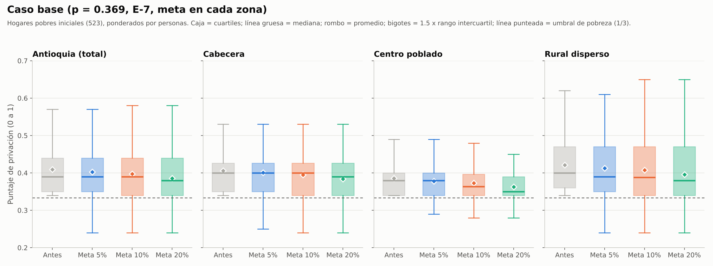
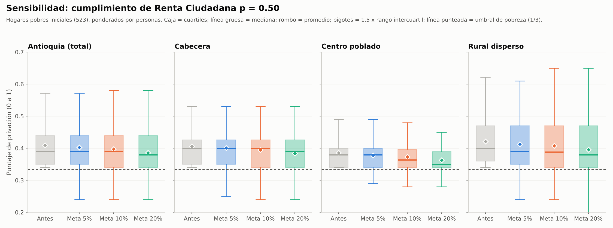
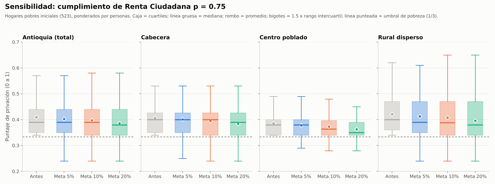
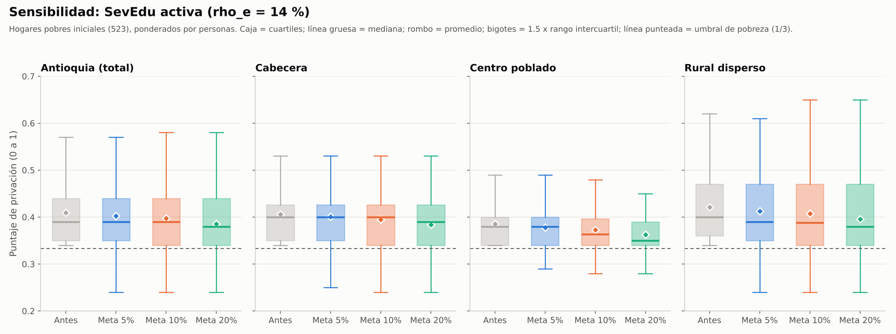
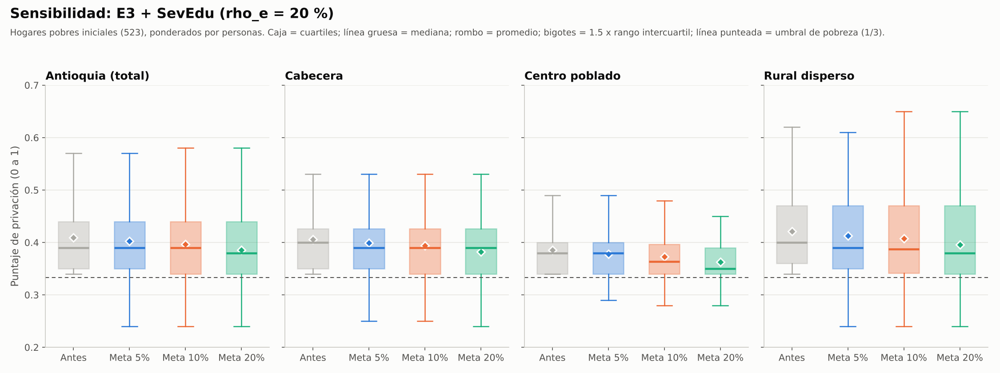
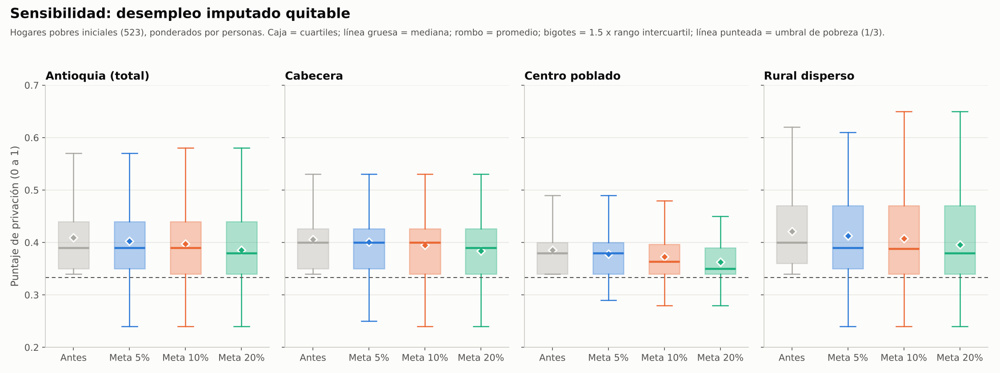
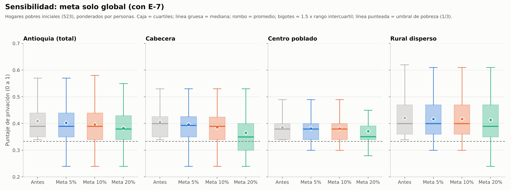
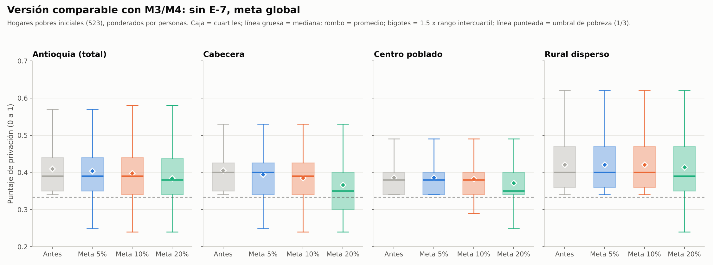
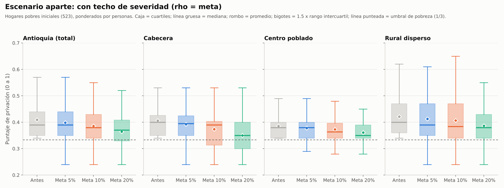

# Cajas y bigotes del Modelo 2: análisis de sensibilidad

*Proyecto IPM Antioquia, Optimización 1 (EAFIT). Para Martín. 10-nov-2026. Datos en `Modelos\Modelo_2\resultados\graficos\` (`resumen_cajas_casos.csv`, `estadisticas_cajas_casos.csv`) y gráficos en `graficos\caja_<caso>.png`. Script: `10_cajas_modelo2.py`. Todas las corridas son `Optimal` con gap ≤ 1e-6.*

## 1. Qué muestra cada diagrama

La "posición" de un hogar pobre es su **puntaje de privación**: la suma de los pesos de los indicadores en que está privado (va de 0 a 1; es pobre si el puntaje es ≥ 1/3 ≈ 0.333). Cada diagrama compara a los **523 hogares pobres iniciales** antes y después de la intervención del Modelo 2 con las metas de reducción de M0 de 5, 10 y 20 %, para Antioquia y para cada zona.

- **Caja:** cuartiles 25 % y 75 %; **línea gruesa:** mediana; **rombo:** promedio; **bigotes:** último dato dentro de 1.5 veces el rango intercuartil; **línea punteada:** umbral de pobreza.
- Todo está **ponderado por personas**, no por hogares de la muestra. Los hogares que salen de la pobreza siguen en la caja con su nuevo puntaje (por debajo de 1/3).
- Una caja que baja o un bigote superior que se acorta significan que mejoró la posición de los hogares, y en especial el bigote superior, que representa a los **más privados**.

## 2. Análisis de sensibilidad que estamos tomando

| # | Caso | Qué cambia frente al caso base |
|---|---|---|
| 1 | Caso base | Caso base: meta en cada zona, E-7, p = 0.369. Es la referencia. |
| 2 | p = 0.50 | Cumplimiento de Renta Ciudadana p = 0.50 (más hogares cumplen, Renta Ciudadana cuesta menos). |
| 3 | p = 0.75 | Cumplimiento p = 0.75. |
| 4 | SevEdu 14 % | Se agrega el techo de severidad educativa: SevEdu baja al menos 14 %. |
| 5 | E3 + SevEdu 20 % | E3 (CLEI de secundaria) permitido y SevEdu baja al menos 20 %. |
| 6 | Desempleo imputado quitable | El desempleo de larga duración sin persona identificada vuelve a ser quitable. |
| 7 | Meta solo global (con E-7) | La meta de M0 se exige solo en el total, no en cada zona (con E-7). |
| 8 | Sin E-7, meta global (comparable M3/M4) | Sin la cobertura obligatoria del art. 67 y con meta global: la versión que usa Jerónimo como referencia para M3 y M4. |
| 9 | Con severidad (ρ = meta) | Escenario aparte: además de la meta de M0, la severidad total baja al menos ρ = meta (5, 10 y 20 %). |

Los casos 2 a 6 son los análisis de sensibilidad del Modelo 2 que corremos desde la subfase 3.7. El caso 7 es la sensibilidad de la meta global, el 8 es la versión comparable con Jerónimo y el 9 es el escenario nuevo que Martín pidió el 10-nov para proteger a los más privados. Falta u = 1 (una intervención por hogar), que depende de `datos_modelo.py`.

## 3. Resultados de cada caso

Costo en mil millones de pesos (mm). "Salen" = hogares de la muestra que dejan de ser pobres. Severidad = reducción de Σ p·s² respecto a 117,908. A inicial = 0.4094.

| Caso | Meta | Costo (mm) | Salen (hogares) | Salen (personas) | H final | A final | Reducción M0 | Reducción severidad |
|---|---|---|---|---|---|---|---|---|
| Caso base | 5% | 105.58 | 19 | 35,650 | 8.96% | 0.4101 | 5.0% | 2.8% |
| Caso base | 10% | 108.66 | 29 | 73,919 | 8.43% | 0.4125 | 10.1% | 4.9% |
| Caso base | 20% | 118.86 | 65 | 149,325 | 7.39% | 0.4186 | 20.1% | 9.1% |
| p = 0.50 | 5% | 88.90 | 19 | 35,650 | 8.96% | 0.4101 | 5.0% | 2.8% |
| p = 0.50 | 10% | 91.98 | 29 | 73,919 | 8.43% | 0.4125 | 10.1% | 4.9% |
| p = 0.50 | 20% | 102.19 | 65 | 149,325 | 7.39% | 0.4186 | 20.1% | 9.1% |
| p = 0.75 | 5% | 73.24 | 19 | 35,650 | 8.96% | 0.4101 | 5.0% | 2.8% |
| p = 0.75 | 10% | 76.32 | 29 | 73,919 | 8.43% | 0.4125 | 10.1% | 4.9% |
| p = 0.75 | 20% | 86.53 | 65 | 149,325 | 7.39% | 0.4186 | 20.1% | 9.1% |
| SevEdu 14 % | 5% | 107.09 | 19 | 35,650 | 8.96% | 0.4101 | 5.0% | 2.8% |
| SevEdu 14 % | 10% | 110.18 | 29 | 73,919 | 8.43% | 0.4125 | 10.1% | 4.9% |
| SevEdu 14 % | 20% | 120.38 | 65 | 149,325 | 7.39% | 0.4186 | 20.1% | 9.1% |
| E3 + SevEdu 20 % | 5% | 78.71 | 15 | 35,550 | 8.96% | 0.4093 | 5.2% | 3.1% |
| E3 + SevEdu 20 % | 10% | 81.35 | 26 | 71,964 | 8.45% | 0.4115 | 10.1% | 5.1% |
| E3 + SevEdu 20 % | 20% | 91.00 | 62 | 148,165 | 7.40% | 0.4178 | 20.1% | 9.3% |
| Desempleo imputado quitable | 5% | 105.58 | 19 | 35,650 | 8.96% | 0.4101 | 5.0% | 2.8% |
| Desempleo imputado quitable | 10% | 108.66 | 29 | 73,919 | 8.43% | 0.4125 | 10.1% | 4.9% |
| Desempleo imputado quitable | 20% | 118.86 | 65 | 149,325 | 7.39% | 0.4186 | 20.1% | 9.1% |
| Meta solo global (con E-7) | 5% | 104.67 | 6 | 37,249 | 8.93% | 0.4107 | 5.1% | 2.9% |
| Meta solo global (con E-7) | 10% | 105.43 | 12 | 74,327 | 8.42% | 0.4133 | 10.0% | 4.9% |
| Meta solo global (con E-7) | 20% | 109.14 | 35 | 139,407 | 7.52% | 0.4114 | 20.0% | 11.0% |
| Sin E-7, meta global (comparable M3/M4) | 5% | 0.35 | 3 | 40,741 | 8.89% | 0.4131 | 5.1% | 2.1% |
| Sin E-7, meta global (comparable M3/M4) | 10% | 1.32 | 12 | 78,223 | 8.37% | 0.4159 | 10.0% | 4.1% |
| Sin E-7, meta global (comparable M3/M4) | 20% | 6.47 | 43 | 141,598 | 7.49% | 0.4131 | 20.0% | 10.3% |
| Con severidad (ρ = meta) | 5% | 105.84 | 18 | 49,302 | 8.77% | 0.4089 | 7.3% | 5.0% |
| Con severidad (ρ = meta) | 10% | 110.40 | 37 | 125,368 | 7.72% | 0.4115 | 17.9% | 10.0% |
| Con severidad (ρ = meta) | 20% | 131.48 | 66 | 180,253 | 6.96% | 0.3972 | 28.6% | 20.0% |

## 4. Distribución de caja de cada caso

### 4.1. Caso base

Caso base: meta en cada zona, E-7, p = 0.369. Es la referencia.

Antioquia (total), puntaje de privación ponderado por personas:

| Grupo | Q1 | Mediana | Q3 | Bigote inf. | Bigote sup. | Promedio | Mínimo | Máximo | % de personas bajo 1/3 |
|---|---|---|---|---|---|---|---|---|---|
| Antes | 0.350 | 0.390 | 0.440 | 0.34 | 0.57 | 0.409 | 0.34 | 0.65 | 0.0% |
| Meta 5% | 0.350 | 0.390 | 0.440 | 0.24 | 0.57 | 0.403 | 0.24 | 0.65 | 5.2% |
| Meta 10% | 0.340 | 0.390 | 0.440 | 0.24 | 0.58 | 0.397 | 0.24 | 0.65 | 10.8% |
| Meta 20% | 0.340 | 0.380 | 0.440 | 0.24 | 0.58 | 0.386 | 0.24 | 0.65 | 21.9% |

Por zona, antes y con la meta de 20 %:

| Zona | Grupo | Mediana | Promedio | Bigote sup. | % de personas bajo 1/3 |
|---|---|---|---|---|---|
| Cabecera | Antes | 0.400 | 0.406 | 0.53 | 0.0% |
| Cabecera | Meta 20% | 0.390 | 0.384 | 0.53 | 22.8% |
| Centro poblado | Antes | 0.380 | 0.386 | 0.49 | 0.0% |
| Centro poblado | Meta 20% | 0.350 | 0.363 | 0.45 | 19.9% |
| Rural disperso | Antes | 0.400 | 0.421 | 0.62 | 0.0% |
| Rural disperso | Meta 20% | 0.380 | 0.396 | 0.65 | 21.0% |

### 4.2. p = 0.50

Cumplimiento de Renta Ciudadana p = 0.50 (más hogares cumplen, Renta Ciudadana cuesta menos).

Antioquia (total), puntaje de privación ponderado por personas:

| Grupo | Q1 | Mediana | Q3 | Bigote inf. | Bigote sup. | Promedio | Mínimo | Máximo | % de personas bajo 1/3 |
|---|---|---|---|---|---|---|---|---|---|
| Antes | 0.350 | 0.390 | 0.440 | 0.34 | 0.57 | 0.409 | 0.34 | 0.65 | 0.0% |
| Meta 5% | 0.350 | 0.390 | 0.440 | 0.24 | 0.57 | 0.403 | 0.24 | 0.65 | 5.2% |
| Meta 10% | 0.340 | 0.390 | 0.440 | 0.24 | 0.58 | 0.397 | 0.24 | 0.65 | 10.8% |
| Meta 20% | 0.340 | 0.380 | 0.440 | 0.24 | 0.58 | 0.386 | 0.18 | 0.65 | 21.9% |

Por zona, antes y con la meta de 20 %:

| Zona | Grupo | Mediana | Promedio | Bigote sup. | % de personas bajo 1/3 |
|---|---|---|---|---|---|
| Cabecera | Antes | 0.400 | 0.406 | 0.53 | 0.0% |
| Cabecera | Meta 20% | 0.390 | 0.384 | 0.53 | 22.8% |
| Centro poblado | Antes | 0.380 | 0.386 | 0.49 | 0.0% |
| Centro poblado | Meta 20% | 0.350 | 0.363 | 0.45 | 19.9% |
| Rural disperso | Antes | 0.400 | 0.421 | 0.62 | 0.0% |
| Rural disperso | Meta 20% | 0.380 | 0.395 | 0.65 | 21.0% |

### 4.3. p = 0.75

Cumplimiento p = 0.75.

Antioquia (total), puntaje de privación ponderado por personas:

| Grupo | Q1 | Mediana | Q3 | Bigote inf. | Bigote sup. | Promedio | Mínimo | Máximo | % de personas bajo 1/3 |
|---|---|---|---|---|---|---|---|---|---|
| Antes | 0.350 | 0.390 | 0.440 | 0.34 | 0.57 | 0.409 | 0.34 | 0.65 | 0.0% |
| Meta 5% | 0.350 | 0.390 | 0.440 | 0.24 | 0.57 | 0.403 | 0.24 | 0.65 | 5.2% |
| Meta 10% | 0.340 | 0.390 | 0.440 | 0.24 | 0.58 | 0.397 | 0.24 | 0.65 | 10.8% |
| Meta 20% | 0.340 | 0.380 | 0.440 | 0.24 | 0.58 | 0.386 | 0.24 | 0.65 | 21.9% |

Por zona, antes y con la meta de 20 %:

| Zona | Grupo | Mediana | Promedio | Bigote sup. | % de personas bajo 1/3 |
|---|---|---|---|---|---|
| Cabecera | Antes | 0.400 | 0.406 | 0.53 | 0.0% |
| Cabecera | Meta 20% | 0.390 | 0.384 | 0.53 | 22.8% |
| Centro poblado | Antes | 0.380 | 0.386 | 0.49 | 0.0% |
| Centro poblado | Meta 20% | 0.350 | 0.363 | 0.45 | 19.9% |
| Rural disperso | Antes | 0.400 | 0.421 | 0.62 | 0.0% |
| Rural disperso | Meta 20% | 0.380 | 0.396 | 0.65 | 21.0% |

### 4.4. SevEdu 14 %

Se agrega el techo de severidad educativa: SevEdu baja al menos 14 %.

Antioquia (total), puntaje de privación ponderado por personas:

| Grupo | Q1 | Mediana | Q3 | Bigote inf. | Bigote sup. | Promedio | Mínimo | Máximo | % de personas bajo 1/3 |
|---|---|---|---|---|---|---|---|---|---|
| Antes | 0.350 | 0.390 | 0.440 | 0.34 | 0.57 | 0.409 | 0.34 | 0.65 | 0.0% |
| Meta 5% | 0.350 | 0.390 | 0.440 | 0.24 | 0.57 | 0.403 | 0.24 | 0.65 | 5.2% |
| Meta 10% | 0.340 | 0.390 | 0.440 | 0.24 | 0.58 | 0.397 | 0.24 | 0.65 | 10.8% |
| Meta 20% | 0.340 | 0.380 | 0.440 | 0.24 | 0.58 | 0.386 | 0.24 | 0.65 | 21.9% |

Por zona, antes y con la meta de 20 %:

| Zona | Grupo | Mediana | Promedio | Bigote sup. | % de personas bajo 1/3 |
|---|---|---|---|---|---|
| Cabecera | Antes | 0.400 | 0.406 | 0.53 | 0.0% |
| Cabecera | Meta 20% | 0.390 | 0.384 | 0.53 | 22.8% |
| Centro poblado | Antes | 0.380 | 0.386 | 0.49 | 0.0% |
| Centro poblado | Meta 20% | 0.350 | 0.363 | 0.45 | 19.9% |
| Rural disperso | Antes | 0.400 | 0.421 | 0.62 | 0.0% |
| Rural disperso | Meta 20% | 0.380 | 0.396 | 0.65 | 21.0% |

### 4.5. E3 + SevEdu 20 %

E3 (CLEI de secundaria) permitido y SevEdu baja al menos 20 %.

Antioquia (total), puntaje de privación ponderado por personas:

| Grupo | Q1 | Mediana | Q3 | Bigote inf. | Bigote sup. | Promedio | Mínimo | Máximo | % de personas bajo 1/3 |
|---|---|---|---|---|---|---|---|---|---|
| Antes | 0.350 | 0.390 | 0.440 | 0.34 | 0.57 | 0.409 | 0.34 | 0.65 | 0.0% |
| Meta 5% | 0.350 | 0.390 | 0.440 | 0.24 | 0.57 | 0.402 | 0.24 | 0.65 | 5.2% |
| Meta 10% | 0.340 | 0.390 | 0.440 | 0.24 | 0.58 | 0.397 | 0.24 | 0.65 | 10.5% |
| Meta 20% | 0.340 | 0.380 | 0.440 | 0.24 | 0.58 | 0.386 | 0.24 | 0.65 | 21.7% |

Por zona, antes y con la meta de 20 %:

| Zona | Grupo | Mediana | Promedio | Bigote sup. | % de personas bajo 1/3 |
|---|---|---|---|---|---|
| Cabecera | Antes | 0.400 | 0.406 | 0.53 | 0.0% |
| Cabecera | Meta 20% | 0.390 | 0.383 | 0.53 | 22.4% |
| Centro poblado | Antes | 0.380 | 0.386 | 0.49 | 0.0% |
| Centro poblado | Meta 20% | 0.350 | 0.363 | 0.45 | 19.9% |
| Rural disperso | Antes | 0.400 | 0.421 | 0.62 | 0.0% |
| Rural disperso | Meta 20% | 0.380 | 0.396 | 0.65 | 21.1% |

### 4.6. Desempleo imputado quitable

El desempleo de larga duración sin persona identificada vuelve a ser quitable.

Antioquia (total), puntaje de privación ponderado por personas:

| Grupo | Q1 | Mediana | Q3 | Bigote inf. | Bigote sup. | Promedio | Mínimo | Máximo | % de personas bajo 1/3 |
|---|---|---|---|---|---|---|---|---|---|
| Antes | 0.350 | 0.390 | 0.440 | 0.34 | 0.57 | 0.409 | 0.34 | 0.65 | 0.0% |
| Meta 5% | 0.350 | 0.390 | 0.440 | 0.24 | 0.57 | 0.403 | 0.24 | 0.65 | 5.2% |
| Meta 10% | 0.340 | 0.390 | 0.440 | 0.24 | 0.58 | 0.397 | 0.24 | 0.65 | 10.8% |
| Meta 20% | 0.340 | 0.380 | 0.440 | 0.24 | 0.58 | 0.386 | 0.24 | 0.65 | 21.9% |

Por zona, antes y con la meta de 20 %:

| Zona | Grupo | Mediana | Promedio | Bigote sup. | % de personas bajo 1/3 |
|---|---|---|---|---|---|
| Cabecera | Antes | 0.400 | 0.406 | 0.53 | 0.0% |
| Cabecera | Meta 20% | 0.390 | 0.384 | 0.53 | 22.8% |
| Centro poblado | Antes | 0.380 | 0.386 | 0.49 | 0.0% |
| Centro poblado | Meta 20% | 0.350 | 0.363 | 0.45 | 19.9% |
| Rural disperso | Antes | 0.400 | 0.421 | 0.62 | 0.0% |
| Rural disperso | Meta 20% | 0.380 | 0.396 | 0.65 | 21.0% |

### 4.7. Meta solo global (con E-7)

La meta de M0 se exige solo en el total, no en cada zona (con E-7).

Antioquia (total), puntaje de privación ponderado por personas:

| Grupo | Q1 | Mediana | Q3 | Bigote inf. | Bigote sup. | Promedio | Mínimo | Máximo | % de personas bajo 1/3 |
|---|---|---|---|---|---|---|---|---|---|
| Antes | 0.350 | 0.390 | 0.440 | 0.34 | 0.57 | 0.409 | 0.34 | 0.65 | 0.0% |
| Meta 5% | 0.350 | 0.390 | 0.440 | 0.24 | 0.57 | 0.402 | 0.24 | 0.65 | 5.5% |
| Meta 10% | 0.340 | 0.390 | 0.440 | 0.24 | 0.58 | 0.397 | 0.24 | 0.65 | 10.9% |
| Meta 20% | 0.340 | 0.380 | 0.430 | 0.24 | 0.55 | 0.383 | 0.24 | 0.65 | 20.4% |

Por zona, antes y con la meta de 20 %:

| Zona | Grupo | Mediana | Promedio | Bigote sup. | % de personas bajo 1/3 |
|---|---|---|---|---|---|
| Cabecera | Antes | 0.400 | 0.406 | 0.53 | 0.0% |
| Cabecera | Meta 20% | 0.350 | 0.365 | 0.53 | 33.3% |
| Centro poblado | Antes | 0.380 | 0.386 | 0.49 | 0.0% |
| Centro poblado | Meta 20% | 0.350 | 0.371 | 0.45 | 11.2% |
| Rural disperso | Antes | 0.400 | 0.421 | 0.62 | 0.0% |
| Rural disperso | Meta 20% | 0.390 | 0.413 | 0.61 | 4.2% |

### 4.8. Sin E-7, meta global (comparable M3/M4)

Sin la cobertura obligatoria del art. 67 y con meta global: la versión que usa Jerónimo como referencia para M3 y M4.

Antioquia (total), puntaje de privación ponderado por personas:

| Grupo | Q1 | Mediana | Q3 | Bigote inf. | Bigote sup. | Promedio | Mínimo | Máximo | % de personas bajo 1/3 |
|---|---|---|---|---|---|---|---|---|---|
| Antes | 0.350 | 0.390 | 0.440 | 0.34 | 0.57 | 0.409 | 0.34 | 0.65 | 0.0% |
| Meta 5% | 0.350 | 0.390 | 0.440 | 0.25 | 0.57 | 0.403 | 0.25 | 0.65 | 6.0% |
| Meta 10% | 0.340 | 0.390 | 0.440 | 0.24 | 0.58 | 0.398 | 0.24 | 0.65 | 11.4% |
| Meta 20% | 0.340 | 0.380 | 0.438 | 0.24 | 0.58 | 0.384 | 0.24 | 0.65 | 20.7% |

Por zona, antes y con la meta de 20 %:

| Zona | Grupo | Mediana | Promedio | Bigote sup. | % de personas bajo 1/3 |
|---|---|---|---|---|---|
| Cabecera | Antes | 0.400 | 0.406 | 0.53 | 0.0% |
| Cabecera | Meta 20% | 0.350 | 0.366 | 0.53 | 31.5% |
| Centro poblado | Antes | 0.380 | 0.386 | 0.49 | 0.0% |
| Centro poblado | Meta 20% | 0.350 | 0.371 | 0.49 | 14.3% |
| Rural disperso | Antes | 0.400 | 0.421 | 0.62 | 0.0% |
| Rural disperso | Meta 20% | 0.390 | 0.414 | 0.62 | 6.9% |

### 4.9. Con severidad (ρ = meta)

Escenario aparte: además de la meta de M0, la severidad total baja al menos ρ = meta (5, 10 y 20 %).

Antioquia (total), puntaje de privación ponderado por personas:

| Grupo | Q1 | Mediana | Q3 | Bigote inf. | Bigote sup. | Promedio | Mínimo | Máximo | % de personas bajo 1/3 |
|---|---|---|---|---|---|---|---|---|---|
| Antes | 0.350 | 0.390 | 0.440 | 0.34 | 0.57 | 0.409 | 0.34 | 0.65 | 0.0% |
| Meta 5% | 0.350 | 0.390 | 0.440 | 0.24 | 0.57 | 0.398 | 0.24 | 0.65 | 7.2% |
| Meta 10% | 0.340 | 0.380 | 0.430 | 0.24 | 0.55 | 0.386 | 0.24 | 0.65 | 18.3% |
| Meta 20% | 0.330 | 0.370 | 0.408 | 0.24 | 0.52 | 0.365 | 0.14 | 0.61 | 26.4% |

Por zona, antes y con la meta de 20 %:

| Zona | Grupo | Mediana | Promedio | Bigote sup. | % de personas bajo 1/3 |
|---|---|---|---|---|---|
| Cabecera | Antes | 0.400 | 0.406 | 0.53 | 0.0% |
| Cabecera | Meta 20% | 0.350 | 0.350 | 0.53 | 33.7% |
| Centro poblado | Antes | 0.380 | 0.386 | 0.49 | 0.0% |
| Centro poblado | Meta 20% | 0.350 | 0.361 | 0.45 | 18.9% |
| Rural disperso | Antes | 0.400 | 0.421 | 0.62 | 0.0% |
| Rural disperso | Meta 20% | 0.380 | 0.386 | 0.55 | 17.8% |

## 5. Qué se puede analizar

**1. Cuatro sensibilidades no mueven las cajas.** El cumplimiento de Renta Ciudadana (p = 0.50 y 0.75), SevEdu activa al 14 % y el desempleo imputado quitable dan las mismas cajas que el caso base: salen los mismos hogares (19, 29 y 65), con los mismos puntajes. Lo único que cambia es el costo (por ejemplo, con 20 %: 118.86 mm en el caso base, 102.19 con p = 0.50, 86.53 con p = 0.75, 120.38 con SevEdu 14 %). Conclusión: esas sensibilidades cambian el presupuesto, no la posición de los pobres. *(En p = 0.50 con 20 %, el puntaje mínimo es 0.18 y no 0.24: es otra solución de igual costo con los mismos resultados, y no cambia ninguna estadística de la caja.)*

**2. E3 + SevEdu 20 % se mueve muy poco.** Salen 15, 26 y 62 hogares (un poco menos que en el caso base) y A es 0.4093 con 5 %, es decir, no sube respecto a la inicial (0.4094). Las cajas son casi iguales; este caso es más barato (78.7 a 91.0 mm), no distinto en posición.

**3. Meta solo global.** La caja con 20 % se comprime un poco más que en el caso base: Q3 baja a 0.430 y el bigote superior a 0.55 (caso base: 0.440 y 0.58). Con la meta solo global, el modelo se concentra en las cabeceras, donde cada hogar representa a más personas, así que saca más gente con menos hogares (35 hogares y 139 mil personas con 20 %, contra 65 y 149 mil).

**4. Versión comparable sin E-7 y meta global.** La forma de las cajas es casi idéntica a la del caso base, pero cuesta apenas 0.35, 1.32 y 6.47 mm. Es la referencia que usa Jerónimo; esas cajas muestran que sin E-7 el Modelo 2 mueve la misma parte de la distribución: la cercana al umbral.

**5. Solo el escenario con severidad mueve a los más privados.** Es el único caso donde la parte alta de la caja baja:

| Antioquia, meta 20 % | Caso base | Con severidad |
|---|---|---|
| Q3 | 0.440 | 0.408 |
| Bigote superior | 0.58 | 0.52 |
| Máximo | 0.65 | 0.61 |
| Promedio | 0.386 | 0.365 |
| Mediana | 0.380 | 0.370 |
| % de personas bajo 1/3 | 21.9 % | 26.4 % |

En el rural disperso, el bigote superior baja de 0.65 a 0.55 con 20 % y el máximo de 0.65 a 0.61; en la cabecera, el máximo cae de 0.61 a 0.53. Con 5 % casi no cambia (el techo de severidad de 5 % apenas obliga). A final: 0.4089, 0.4115 y 0.3972 (con 5, 10 y 20 %), frente a 0.4101, 0.4125 y 0.4186 del caso base. Esto es lo que buscaba la intención del proyecto: que los más privados no queden igual. El costo es +0.26, +1.74 y +12.62 mm sobre el caso base.

**6. En el caso base, los más privados no mejoran.** En el rural disperso el máximo (0.65) es el mismo antes y después, y el bigote superior pasa de 0.62 a 0.65 con 10 % y 20 %. Eso es un efecto de la regla del gráfico, no un empeoramiento: el bigote llega hasta el último dato dentro de 1.5 veces el rango intercuartil, y cuando bajan los cuartiles inferiores (por los hogares que salen) el límite sube y deja entrar a un hogar de 0.65 que antes estaba fuera. Ningún hogar quedó con más privaciones que al inicio.

**7. Siempre se ven los mismos hogares.** Con las metas de 5, 10 y 20 %, el modelo saca primero a los hogares cercanos al umbral (los más baratos). Por eso la mediana baja poco (0.39 a 0.38) y la caja casi no se mueve: lo que cambia es el borde inferior (mínimo de 0.34 a 0.24) y la proporción de personas bajo 1/3.

## 6. Límites de este informe

- Las cajas usan el puntaje de privación de los 523 hogares pobres iniciales; no incluyen a los no pobres.
- Las metas son de un solo año y los hogares son los de la muestra de 2025, ponderados por personas.
- El diagrama muestra la posición, no el costo; el costo de cada caso está en la sección 3.
- Falta el escenario u = 1 (una intervención por hogar), que depende de `datos_modelo.py` y de tu permiso para tocarlo.
