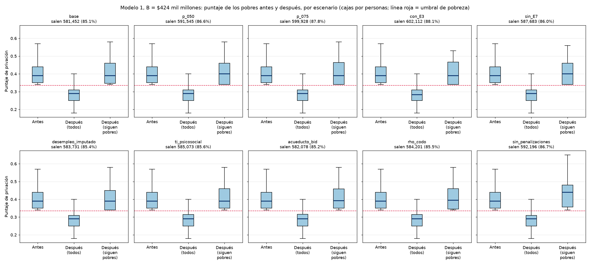
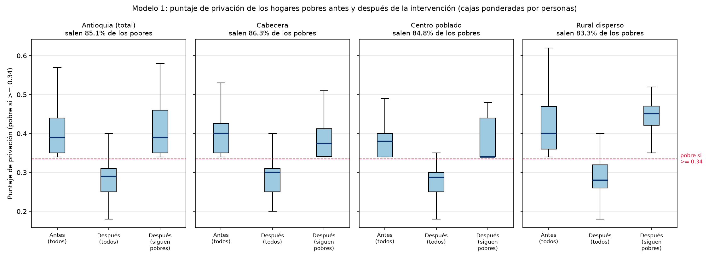

# Informe: posición de los pobres antes y después de la intervención (Modelo 1, análisis de sensibilidad)

*Corridas del 10 al 12 de noviembre de 2026, en el PC de Martín (PuLP 3.3.2 + HiGHS, gap 1e-6). Presupuesto B = $424 mil millones, el de referencia del Modelo 1.*

## 1. Qué se mide y cómo leer una caja

- **Posición** = puntaje de privación del hogar (suma de los pesos de sus privaciones, de 0 a 1). Es pobre si el puntaje es **≥ 0.34**; mientras más alto, más pobre.
- La población son los **523 hogares pobres** de la muestra de Antioquia (de 3,732 hogares). Cada hogar pesa por sus personas (`FEX_C × PERSONAS`), así que las cajas describen a **personas**, no a hogares.
- Cada caja muestra la mediana (línea gruesa), el 50 % central (de Q1 a Q3) y los bigotes (hasta 1.5 veces el rango intercuartílico; los valores extremos no se dibujan).
- Tres cajas por escenario:
  1. **Antes**: todos los pobres, con su puntaje inicial.
  2. **Después (todos)**: esos mismos hogares tras la intervención. Los que quedan bajo la línea roja salieron de la pobreza.
  3. **Después (siguen pobres)**: solo los que no salieron. Muestra qué tan lejos del umbral quedan.
- El puntaje final se recalcula con la misma cuenta del modelo (`ModeloIPMBase.recalcular`): puntaje inicial menos los pesos de las privaciones quitadas. En los 10 escenarios coincide, hogar por hogar, con la variable de salida del MILP.

## 2. Análisis de sensibilidad que estamos tomando

Todos usan **r por el codo de la curva H contra r** de cada corrida y **ρ por la regla de la brecha** (el menor ρ con A ≤ A₀), salvo donde se indica. Dos etapas: max H y luego min severidad. ρ_e = 14 %, salvo con_E3.

| Escenario | Qué cambia frente al caso base |
|---|---|
| `base` | Caso base: p = 0.369 de cumplimiento de Renta Ciudadana, sin E3, cobertura obligatoria del art. 67 (E-7), desempleo sin persona identificada no se paga (D8). |
| `p_050` | Cumplimiento de Renta Ciudadana p = 0.50. |
| `p_075` | Cumplimiento p = 0.75. |
| `con_E3` | Se permite la estrategia E3 (CLEI de secundaria; supuesto: atraso ≥ 2 equivale a 2 años por fuera) y ρ_e sube a 20 %. |
| `sin_E7` | Sin la cobertura obligatoria del art. 67 (versión comparable con los Modelos 3 y 4 de Jerónimo). |
| `desempleo_imputado` | Se imputa un desocupado a los hogares con desempleo de larga duración sin persona identificada (D8 como sensibilidad). |
| `ti_psicosocial` | Costo del trabajo infantil con apoyo psicosocial (más bajo). |
| `acueducto_bid` | Acueducto rural con el costo bajo de aljibe (piloto BID Guachené, $9.7 millones). |
| `rho_codo` | ρ por el codo de la curva H contra severidad, en lugar de la regla de la brecha (política de contraste). |
| `sin_penalizaciones` | ρ = 0, r = 0 y sin techo de SevEdu: H puro, solo con E-7. |

**No incluido:** el escenario `u_1` (una intervención por hogar), porque `cargar_datos` aún lanza `NotImplementedError`.

## 3. Resultados por escenario

| Escenario | Personas que salen | % de pobres que salen | r | ρ | A (A₀ = 0.4094) | ¿A ≤ A₀? | Salida Cabecera / C. poblado / Rural |
|---|---|---|---|---|---|---|---|
| base | 581,452 | 85.1 % | 0.833 | 47.4 % | 0.4091 | sí | 86.3 / 84.8 / 83.3 % |
| p_050 | 591,545 | 86.6 % | 0.850 | 48.2 % | 0.4087 | sí | 87.9 / 85.2 / 85.0 % |
| p_075 | 599,928 | 87.8 % | 0.872 | 48.9 % | 0.4083 | sí | 88.2 / 87.9 / 87.2 % |
| con_E3 | 602,112 | 88.1 % | 0.871 | 49.5 % | 0.4081 | sí | 88.8 / 88.3 / 87.1 % |
| sin_E7 | 587,683 | 86.0 % | 0.838 | 48.1 % | 0.4090 | sí | 87.9 / 83.9 / 83.8 % |
| desempleo_imputado (ver salvedad 1) | 583,731 | 85.4 % | 0.833 | 47.6 % | 0.4087 | sí | 86.9 / 85.1 / 83.4 % |
| ti_psicosocial | 585,073 | 85.6 % | 0.839 | 47.7 % | 0.4083 | sí | 86.9 / 84.7 / 84.0 % |
| acueducto_bid | 582,078 | 85.2 % | 0.832 | 47.4 % | 0.4087 | sí | 86.3 / 86.1 / 83.2 % |
| rho_codo | 584,201 | 85.5 % | 0.833 | 46.9 % | 0.4127 | **no** | 86.9 / 85.6 / 83.4 % |
| sin_penalizaciones | 592,196 | 86.7 % | 0 | n/a | 0.4399 | **no** | 90.5 / 91.1 / 79.9 % |

El costo en todos los casos es de $424.0 mil millones (se gasta todo el presupuesto). El H inicial es 9.45 % y baja a entre 1.12 % (con_E3) y 1.41 % (base).

## 4. Distribución de cajas por escenario



Caso base, por zona:



### 4.1 Total Antioquia (todos los escenarios)

La caja **Antes** es idéntica en los 10 escenarios (mismos hogares): bigote inferior 0.34, Q1 0.35, mediana 0.39, Q3 0.44, bigote superior 0.57.

| Escenario | Después (todos): Q1 / mediana / Q3 | Después (siguen pobres): Q1 / mediana / Q3 | Bigote sup. (siguen pobres) |
|---|---|---|---|
| base | 0.25 / 0.29 / 0.31 | 0.35 / 0.39 / 0.46 | 0.58 |
| p_050 | 0.25 / 0.29 / 0.31 | 0.34 / 0.40 / 0.46 | 0.58 |
| p_075 | 0.25 / 0.29 / 0.31 | 0.34 / 0.39 / 0.46 | 0.58 |
| con_E3 | 0.25 / 0.28 / 0.31 | 0.34 / 0.39 / 0.47 | 0.53 |
| sin_E7 | 0.25 / 0.29 / 0.31 | 0.34 / 0.40 / 0.46 | 0.56 |
| desempleo_imputado | 0.25 / 0.29 / 0.31 | 0.34 / 0.39 / 0.45 | 0.58 |
| ti_psicosocial | 0.25 / 0.29 / 0.31 | 0.35 / 0.39 / 0.46 | 0.58 |
| acueducto_bid | 0.25 / 0.29 / 0.32 | 0.35 / 0.39 / 0.46 | 0.58 |
| rho_codo | 0.25 / 0.29 / 0.31 | 0.35 / 0.39 / 0.46 | 0.58 |
| sin_penalizaciones | 0.25 / 0.29 / 0.31 | 0.36 / **0.44** / 0.48 | **0.65** |

(Valores a dos decimales; los puntajes son múltiplos de 0.01. Todas las estadísticas, por zona y por caja, están en `data/processed/modelo1/cajas_sensibilidades.csv`.)

### 4.2 Por zona: los que siguen pobres (Q1 / mediana / Q3)

| Escenario | Cabecera | Centro poblado | Rural disperso |
|---|---|---|---|
| base | 0.34 / 0.37 / 0.41 | 0.34 / 0.34 / 0.44 | **0.42 / 0.45 / 0.47** |
| con_E3 | 0.34 / 0.36 / 0.43 | 0.34 / 0.35 / 0.44 | 0.39 / 0.45 / 0.48 |
| rho_codo | 0.34 / 0.38 / 0.41 | 0.34 / 0.34 / 0.44 | 0.42 / 0.45 / 0.48 |
| sin_penalizaciones | 0.34 / 0.39 / 0.45 | 0.34 / 0.44 / 0.44 | **0.44 / 0.47 / 0.52** |

## 5. Qué se concluye

1. **La intervención mueve a la mayoría bajo la línea.** En todos los escenarios la mediana de los pobres baja de 0.39 a 0.28 o 0.29, y entre 85 y 88 % de las personas sale de la pobreza. Las cajas "Antes" y "Después (todos)" casi no cambian entre escenarios: las sensibilidades de datos mueven la cifra en menos de 3.6 % (de 581,452 a 602,112 personas), no la forma de la distribución.
2. **Los que no salen quedan donde empezaron, o más arriba.** En el caso base la mediana de los que siguen pobres (0.39) es igual a la de antes de intervenir. Una lectura probable, que no he comprobado, es que el modelo saca primero a los hogares más baratos de sacar y quedan los más hundidos. Esto no viola la regla de la brecha (A ≤ A₀ se cumple en el promedio total), pero conviene decirlo a la profesora.
3. **La zona rural es donde más se nota.** Los que siguen pobres en el rural tienen mediana 0.45 contra 0.37 en la cabecera. El piso de equidad r obliga a sacar gente del rural (83.3 %), pero los hogares rurales que quedan están más lejos del umbral.
4. **`sin_penalizaciones` es el contraste.** Saca 10,744 personas más (+1.8 %), pero la mediana de los que quedan sube a 0.44, el bigote superior a 0.65 y A a 0.4399 (mayor que A₀ = 0.4094). El rural es la zona que paga: sale solo el 79.9 % contra 90.5 % en la cabecera. Es la imagen de por qué el modelo lleva r, ρ y ρ_e.
5. **`rho_codo` no cumple la regla** (A = 0.4127 > A₀), pero su caja es casi igual a la del caso base. Refuerza usar la regla de la brecha como criterio principal de ρ.
6. **`con_E3` es el único con una forma distinta** entre los que cumplen: el bigote superior de los que siguen pobres baja a 0.53 y la mediana de "Después (todos)" a 0.28. No he verificado por qué; puede ser que con E3 salgan hogares con puntajes altos.

## 6. Salvedades

1. **`desempleo_imputado`:** esta corrida dio **583,731** personas. La corrida anterior (10-nov, P24) había dado 585,762. Las otras 8 sensibilidades coinciden con P24. No he encontrado el motivo. Esta corrida también tardó 7,572 s, mucho más que el resto (de 309 a 982 s), lo que sugiere que la búsqueda de ρ o de r pasó por un tramo difícil para el solver. **No está verificado**; hay que repetirla antes de citar esa cifra.
2. El caso base da **581,452** aquí y en la nube, y **581,456** en la corrida directa de `08_modelo1.py`: la diferencia de 4 personas es de redondeo del solver.
3. Las cajas se dibujan solo sobre los 523 hogares pobres iniciales. Los no pobres no cambian H ni A.
4. Los bigotes excluyen valores extremos (no se dibujan). Con puntajes en múltiplos de 0.01 y pocos hogares, varias estadísticas se repiten (por ejemplo Q1 = mediana = 0.34 en Centro poblado).

## 7. Cómo reproducirlo

```bash
.venv\Scripts\python.exe Modelos\08_modelo1_cajas_sens.py      # corre los 10 escenarios (reanudable; desempleo_imputado tardó más de 2 h)
.venv\Scripts\python.exe Modelos\08_modelo1_cajas_graficar.py  # dibuja y calcula las cajas
```

Archivos: `data/processed/modelo1/sens/*_plan_hogar.csv` (plan por hogar), `sens/resumen_sens.csv`, `cajas_sensibilidades.csv` y `cajas_sensibilidades.png`.
