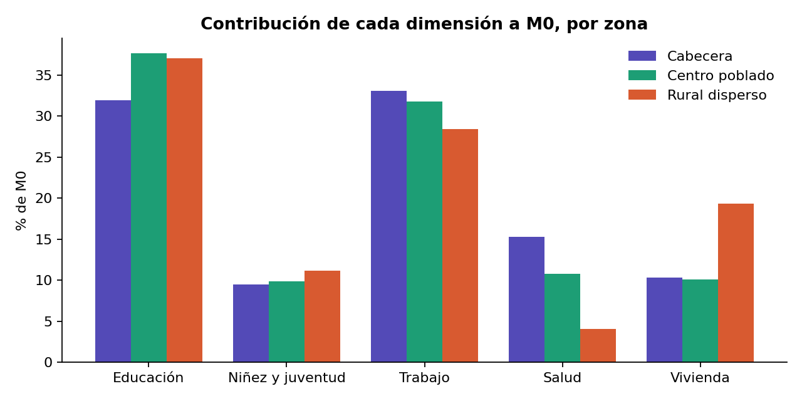
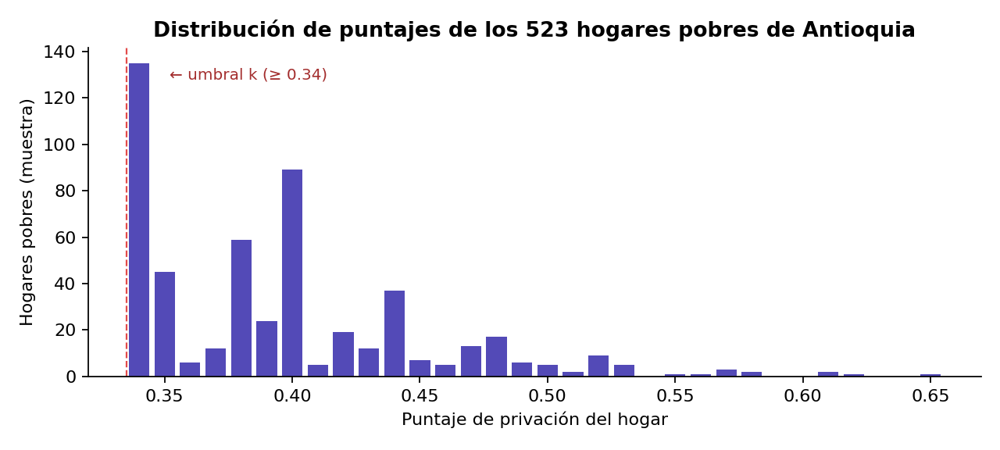
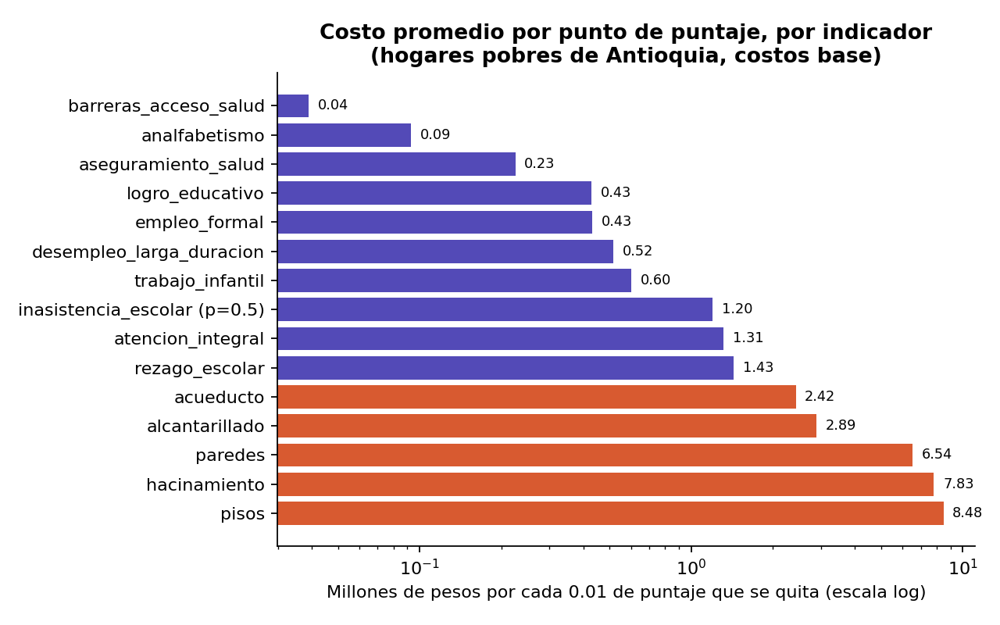

# Informe del Modelo 1 — Presupuesto fijo con equidad por zona

**Proyecto final de Optimización 1 (EAFIT)** · Reducción de la pobreza multidimensional en Antioquia con microdatos IPM 2025 del DANE
**Estado:** formulación y parámetros cerrados (21-oct-2026); objetivo actualizado con el techo de severidad (26-oct-2026). Falta programar `05_conteo_personas.py`, `06_parametros.py` y `08_modelo1.py`.

> Fuentes internas: `docs/resumen_proyecto_ipm.md` (decisiones), `docs/reglas_conteo_personas.md` (conteo de personas validado),
> `docs/paper_modelos.md` (ecuaciones del paper de Hamie, Hlasny y Jouni, 2024).

---

## 0. La pregunta del Modelo 1: el cambio de paradigma político

Los Modelos 1 y 2 se pueden ver como dos alcaldes con estilos distintos de gobernar:

- **El alcalde del Modelo 2** promete bajar la pobreza a una meta exacta y le pide a su secretario de hacienda:
  *"calcule el mínimo dinero que necesitamos para cumplir esta promesa"*. **Minimiza el costo sujeto a una meta de pobreza.**
- **El alcalde del Modelo 1** revisa la cuenta del municipio y ve que solo tiene un presupuesto fijo $B$. Le dice a su secretario de planeación:
  *"tenemos esta plata, ni un peso más; calcule cómo invertirla para bajar la pobreza lo máximo posible"*.
  **Minimiza la pobreza sujeto a un presupuesto fijo.**

Relación con el paper de referencia (Hamie et al., 2024):

| Nuestro proyecto | Paper | Pregunta que responde |
|---|---|---|
| — | Modelo 1a / 1b (heurística iterativa, sin costos) | No es un MILP; sirve como *benchmark* ingenuo |
| **Modelo 1 (presupuesto fijo)** | **"Dual" del Modelo 2** | Con $B$ pesos, ¿cuánta pobreza se elimina? |
| Modelo 2 (meta política) | Modelo 2 (mín. esfuerzo s.a. meta) | ¿Cuánto cuesta llegar a la meta? |
| Modelos 3 y 4 (Jerónimo) | Modelos 3 y 4 | Focalización geográfica / demográfica |

Nuestro Modelo 1 **no** es el Modelo 1 del paper: conserva los supuestos del Modelo 2 (información perfecta, decisión hogar por hogar,
costo marginal constante, indicadores independientes) e intercambia los papeles de objetivo y restricción. Este cambio se justifica porque
la pregunta de política en Antioquia suele partir de un presupuesto anual dado, no de una meta.

---

## 1. ¿Cómo volvemos computables las restricciones con implicación?

Las condiciones del índice son implicaciones lógicas ("si el puntaje es ≥ k, entonces…"), que un solver no entiende directamente.
El truco del álgebra de Boole es que **una implicación $A \Rightarrow B$ equivale a "pasa B, o NO pasa A" ($B \lor \lnot A$)**.
Un "o" se puede programar con una **variable binaria auxiliar** que funciona como interruptor: obliga al solver a escoger uno de los dos caminos.

### 1.1 Condición de pobreza (Con 2 del paper)

*Si la suma ponderada de privaciones es ≥ k, entonces la contribución $C_i$ es esa suma ponderada.*
Traducción booleana: o $C_i$ es igual a la suma ponderada, o la suma es < k. Con la binaria $b1_i$ y una constante $bigM$:

$$C_i + bigM\cdot b1_i \ \ge\ \sum_j N_{ij}\,w_j\,HS_i\,HW_i \qquad \text{(Lin 1)}$$
$$C_i - bigM\cdot b1_i \ \le\ \sum_j N_{ij}\,w_j\,HS_i\,HW_i \qquad \text{(Lin 2)}$$
$$\sum_j N_{ij}\,w_j - (1-b1_i)\cdot bigM \ <\ k \qquad \text{(Lin 3)}$$

- Si $b1_i = 0$, la $bigM$ desaparece de Lin 1 y Lin 2: $C_i$ queda atrapado entre "≥" y "≤" de la misma suma, así que es **exactamente igual** a ella (el hogar sigue pobre).
- Si $b1_i = 1$, desaparece la $bigM$ de Lin 3: el solver tiene que asegurar que la suma sea **menor que k** (el hogar sale de la pobreza).

### 1.2 Condición de no pobreza (Con 3 del paper)

*Si la suma es < k, entonces $C_i = 0$.* Traducción booleana: o $C_i = 0$, o la suma es ≥ k. Con la binaria $b2_i$ (el paper permite usar $b2_i = 1 - b1_i$):

$$C_i - bigM\cdot b2_i \ \le\ 0 \qquad \text{(Lin 4)}$$
$$\sum_j N_{ij}\,w_j + bigM\,(1-b2_i) \ \ge\ k \qquad \text{(Lin 5)}$$

- Si $b2_i = 0$: queda $C_i \le 0$ y, como $C_i \ge 0$, el solver asigna $C_i = 0$.
- Si $b2_i = 1$: queda $\sum_j N_{ij} w_j \ge k$; el modelo confirma que el hogar sí está sobre el umbral.

Con estas cinco inecuaciones lineales desaparecen las flechas lógicas ($\Rightarrow$) y el solver (HiGHS vía PuLP) puede decidir de forma exacta quién recibe cada intervención.

### 1.3 Nuestra versión compacta (la que se programa)

En el Modelo 1 usamos una sola binaria por hogar, $y_i = 1$ si el hogar **sale** de la pobreza (la misma convención que $b1_i$ del paper), y dos restricciones:

$$s_i \ \le\ 0.33 + M_i\,(1 - y_i) \qquad\qquad C_i \ \ge\ s_i - y_i$$

donde $s_i = \sum_{j} w_j\,M_{ij}\,(1 - x_{ij})$ es el puntaje del hogar después de intervenir. Tres detalles técnicos:

1. **"< k" se escribe "≤ 0.33".** Todos los pesos (0.1, 0.05, 0.04) son múltiplos de 0.01, así que los puntajes también lo son: "no pobre" equivale exactamente a $s_i \le 0.33$. No hace falta un $\varepsilon$.
2. **bigM por hogar: $M_i = c_i^0 - 0.33$** (actualizado 27-oct-2026; antes se usaba $M = 1$). Cuando $y_i = 0$, la restricción solo necesita
   quedar apagada, y como intervenir nunca sube el puntaje, $s_i \le c_i^0$: el valor mínimo de $M_i$ que lo logra es $c_i^0 - 0.33$, la $bigM$ más
   ajustada posible. Ambas versiones son exactas y dan el **mismo óptimo**; la diferencia está en la relajación lineal (con $0 \le y_i \le 1$).
   Ejemplo, hogar en 0.40 sin intervenir: con $M = 1$ la relajación permite $y_i \le 0.93$ (casi una salida "gratis"); con $M_i = 0.07$ obliga a
   $y_i \le 0$. Una relajación más ajustada da cotas más cercanas al óptimo y el *branch-and-bound* poda más rápido, lo que importa al barrer $B$ y $\rho$.
3. **Por qué bastan dos restricciones.** El objetivo premia $y_i = 1$ y castiga $C_i$, así que el solver nunca "regala" un $C_i$ mayor al necesario: Lin 2 y Lin 4 se cumplen solas en el óptimo, y Lin 5 sobra porque el solver no dejaría $y_i = 0$ en un hogar que ya cruzó el umbral. Como verificación, H y M0 se **recalculan** después de resolver a partir de $x_{ij}$, con la misma fórmula de `resumen()` de `04_linea_base.py`.

> **Actualización (26-oct-2026):** con el objetivo decidido en §3.4, M0 sale del objetivo y la restricción $C_i \ge s_i - y_i$ ya no se usa (ver §4). La restricción de salida se mantiene, con la $bigM$ por hogar: $s_i \le 0.33 + M_i(1-y_i)$.

---

## 2. Línea base: la "foto" de la pobreza antes de invertir un peso (`04_linea_base.py`)

El script lee `data/processed/hogares_antioquia.csv`, arma la matriz de privaciones $M_{ij}$ y los pesos $w_j$, recalcula el puntaje de cada hogar
y usa el **peso poblacional** $p_i = HW_i \cdot HS_i$ (cuántas personas reales representa cada hogar de la muestra) para hablar de personas y no de filas.

### 2.1 Los tres números principales

| Indicador | Pregunta que responde | Cabecera | Centro poblado | Rural disperso | **Antioquia** |
|---|---|---|---|---|---|
| Hogares (muestra) | — | 1,670 | 613 | 1,449 | **3,732** |
| Hogares pobres (muestra) | — | 127 | 103 | 293 | **523** |
| Personas | — | 5,849,129 | 385,721 | 996,904 | **7,231,754** |
| **H₀** | ¿Cuántos son pobres? | 6.21 % | 17.91 % | 25.18 % | **9.45 %** |
| **A₀** | ¿Qué tan pobres son los pobres? | 40.58 % | 38.56 % | 42.11 % | **40.94 %** |
| **M0** | Las dos cosas juntas (H × A) | 0.0252 | 0.0691 | 0.1060 | **0.0387** |

Personas en pobreza: **683,406**. Hogares reales representados: 2,642,032.

### 2.2 ¿Qué privaciones pesan más?

Para cada indicador: **sin censurar** (% de toda la población que la tiene), **censurada** (% que la tiene y además es pobre; es la que cuenta)
y **contribución** (% de M0 que explica; suman 100 %).

| Dimensión | Indicador | Peso | Sin censurar | Censurada | Contribución |
|---|---|---|---|---|---|
| Educación | logro_educativo | 0.10 | 34.59 % | 8.41 % | 21.74 % |
| | analfabetismo | 0.10 | 7.61 % | 4.89 % | 12.63 % |
| Niñez y juventud | inasistencia_escolar | 0.05 | 2.11 % | 1.14 % | 1.47 % |
| | rezago_escolar | 0.05 | 24.43 % | 4.78 % | 6.18 % |
| | atencion_integral | 0.05 | 5.77 % | 1.02 % | 1.32 % |
| | trabajo_infantil | 0.05 | 1.91 % | 0.91 % | 1.17 % |
| Trabajo | desempleo_larga_duracion | 0.10 | 9.65 % | 2.61 % | 6.75 % |
| | empleo_formal | 0.10 | 67.10 % | 9.45 % | 24.43 % |
| Salud | aseguramiento_salud | 0.10 | 7.02 % | 1.76 % | 4.54 % |
| | barreras_acceso_salud | 0.10 | 7.89 % | 2.35 % | 6.07 % |
| Vivienda | acueducto | 0.04 | 8.25 % | 3.68 % | 3.81 % |
| | alcantarillado | 0.04 | 11.73 % | 4.62 % | 4.78 % |
| | pisos | 0.04 | 3.52 % | 2.06 % | 2.13 % |
| | paredes | 0.04 | 2.21 % | 1.19 % | 1.23 % |
| | hacinamiento | 0.04 | 5.61 % | 1.69 % | 1.75 % |

**Lectura:** educación y trabajo explican ~65 % de la pobreza en las tres zonas. Vivienda pesa casi el doble en lo rural disperso (19 % contra 10 %)
y salud pesa mucho más en la cabecera (15 % contra 4 %). La censurada de `empleo_formal` (9.45 %) es igual a H₀: **el 100 % de los pobres es informal**.

### 2.3 ¿Qué tan lejos están los pobres de dejar de serlo?

| Zona | Pobres | Privaciones promedio | Puntaje promedio | Salen con una sola intervención |
|---|---|---|---|---|
| Cabecera | 127 | 4.83 | 0.40 | 81.1 % |
| Centro poblado | 103 | 4.51 | 0.38 | 83.5 % |
| Rural disperso | 293 | 5.17 | 0.40 | 74.1 % |
| **Total** | **523** | **4.96** | **0.40** | **77.6 %** |

**Por qué importa para el Modelo 1:** 135 hogares están en 0.34, justo encima del umbral, y el 77.6 % sale quitando una sola privación.
Eso predice que H va a caer **rápido al principio** de la curva $B \rightarrow H$ (hay salidas baratas) y después se va a aplanar,
cuando solo queden hogares que necesitan dos o tres intervenciones.

---

## 3. Definición de M0 y elección del objetivo

### 3.1 MPI es el índice (= M0); la meta es otra cosa

En el paper, como en el MPI global de OPHI/PNUD, $\text{MPI} = H \times A = M_0$. Es un **nivel** (una foto), no un porcentaje de reducción.
Lo que se fija como objetivo de política es **cuánto bajarlo**: por ejemplo, la meta ODS 1.2 de reducirlo a la mitad.

| | Valor |
|---|---|
| MPI inicial (M0) | 0.0387 |
| Meta de reducción | 50 % |
| MPI objetivo | ≤ 0.01935 |

### 3.2 La confusión colombiana

| Nombre | Lo que mide | Valor en Antioquia |
|---|---|---|
| "IPM" del DANE | **H** (incidencia) | 9.45 % |
| "MPI" del paper / OPHI | **M0 = H × A** | 0.0387 |

Por eso en este informe se escribe siempre **H** o **M0**, nunca "IPM/MPI" a secas.

### 3.3 Ejemplo con 10 personas

| Persona | Puntaje | ¿Pobre? | $C_i$ |
|---|---|---|---|
| 1 | 0.80 | Sí | 0.80 |
| 2 | 0.40 | Sí | 0.40 |
| 3–10 | 0.20 c/u | No | 0 |

H = 2/10 = 0.20 · A = (0.80 + 0.40)/2 = 0.60 · M0 = 0.20 × 0.60 = 0.12 = (0.80 + 0.40)/10.
Si la persona 1 baja de 0.80 a 0.40, **H no cambia** (sigue pobre) pero **M0 baja a 0.08**: M0 registra la mejora en intensidad y H no.

### 3.4 Objetivo decidido: H principal, techo de severidad y severidad como desempate

> ✅ **Decidido por Martín (26-oct-2026)**, opción C (ε-restricción). Reemplaza la propuesta anterior de usar M0 como desempate.

**Por qué no basta con H.** Maximizar H premia cruzar el umbral, no reducir privaciones. En Antioquia, el 49 % de los hogares pobres está a 0.05 o menos
del umbral, así que un modelo de H puro gasta el presupuesto en los "menos pobres" y deja intactos a los más pobres. La intensidad A de los que siguen
pobres **sube** (la brecha relativa crece).

**Severidad.** Se usa la idea de Foster-Greer-Thorbecke con α = 2 aplicada al puntaje $s_i$ de cada hogar:

$$\text{Sev}(x) = \sum_{i \in I^P} HW_i\,HS_i\; s_i^2$$

- El cuadrado hace que reducir privaciones de un hogar muy pobre valga más: 0.80 → 0.70 baja 0.15, mientras que 0.40 → 0.30 baja 0.07.
- Se calcula sobre los **pobres iniciales** y **sin censurar**: si un hogar sale, su $s_i^2$ sigue contando con su valor nuevo. Si se censurara a 0,
  la severidad volvería a premiar el cruce del umbral.
- Es sensible a la desigualdad entre los pobres: (0.5, 0.5) y (0.4, 0.6) tienen la misma A, pero la severidad del segundo es mayor (0.52 contra 0.50).
- Aclaración para la defensa: en Alkire-Foster (2011) la familia $M_\alpha$ con α ≥ 1 solo está definida para indicadores cardinales; con indicadores
  binarios solo aplica M0. Esta severidad es una extensión inspirada en FGT, calculada sobre el puntaje $s_i$.
- En la línea base, $\text{Sev}_0 = \sum_{i\in I^P} HW_i HS_i (c_i^0)^2 \approx 117{,}908$ (0.0163 por persona; M0 = 0.0387).

**Objetivo y techo.** El objetivo sigue siendo sacar personas de la pobreza, y la severidad entra de dos formas:

$$\max\ \sum_{i\in I^P} HW_i\,HS_i\,y_i \;-\; \lambda \sum_{i \in I^P} HW_i\,HS_i\,q_i \qquad \text{s.a.} \qquad \sum_{i\in I^P} HW_i\,HS_i\,q_i \le (1-\rho)\,\text{Sev}_0$$

1. **Techo (ε-restricción).** $\rho$ es la reducción mínima de severidad exigida. Con $\rho = 0$ se recupera el modelo de H puro y, con el $\rho$ máximo
   factible, el modelo se acerca al de severidad mínima. Barrer $\rho$ produce la frontera de Pareto entre personas que salen y severidad.
2. **Desempate lexicográfico por severidad.** Entre planes que sacan a las mismas personas, el modelo escoge el que deja menos severidad, así que el
   presupuesto sobrante va a los más pobres en vez de desperdiciarse. Para que el desempate nunca compense una sola salida:

$$\lambda < \frac{\min_i HW_i HS_i}{\text{Sev}_0} \approx 3 \times 10^{-4}$$

**Cómo se escoge $\rho$.** No se fija antes de correr el modelo. Primero se calculan los extremos (corrida con $\rho = 0$ y corrida que minimiza la
severidad s.a. presupuesto y equidad), después se barre $\rho$ entre ellos, y sobre la frontera se escoge con un criterio explícito:
- **Codo:** el punto de la frontera más alejado de la recta entre los dos extremos (a partir de ahí, cada punto de severidad cuesta muchas salidas).
- **Regla "la brecha no crece":** el $\rho$ más laxo con el que la intensidad A de los que siguen pobres no supera $A_0$.

**Qué reportar siempre:** H, A, M0 y severidad. Si solo se reporta H, los planes con $\rho > 0$ parecen peores de lo que son.

### 3.5 Severidad educativa del rezago (decidido por Martín 28-oct-2026; pendiente de acordar con Jerónimo)

**Problema.** El IPM mide el rezago como sí/no. En un año solo puede salir de la privación un niño con 1 año de atraso, así que el modelo
**abandona** a los niños con 2 o más años de atraso (132 de 215), que son justamente los más rezagados. Ni la severidad del §3.4 los ve,
porque se calcula sobre el puntaje binario del hogar.

**Idea.** Debajo del indicador binario hay una variable **cardinal**: los años de atraso $a_k$ de cada niño. Sobre ella se mide una
severidad propia (FGT con α = 2). Aquí la severidad es plenamente legítima en Alkire-Foster, porque $M_\alpha$ con α ≥ 1 sí está definido para
variables cardinales.

Para cada niño rezagado $k \in K$ (7–17 años, en hogares pobres al inicio), con atraso inicial $a_k^0$ y $z_k = 1$ si se le nivela un año:

$$\text{SevEdu} = \sum_{k\in K} HW_k\,(a_k^0 - z_k)^2 = \text{SevEdu}_0 - \sum_{k\in K} HW_k\,(2a_k^0 - 1)\,z_k$$

Como $z_k$ es binaria, $(a^0 - z)^2 = (a^0)^2 - (2a^0-1)z$: la expresión es **lineal y exacta**, sin cortes. Nivelar a un niño con 1 año de atraso
baja la severidad en 1; a uno con 3 años, en 5; a uno con 5 años, en 9. El techo premia a los más rezagados.

**Datos de Antioquia** (personas ponderadas con `FEX_C`): 215 niños rezagados, que representan ≈ 113,216 niños; atraso medio 2.63 años;
$\text{SevEdu}_0 \approx 1{,}291{,}034$ (cabecera 697,969; centro poblado 64,426; rural disperso 528,638).

**Qué se dice en la defensa.** Nivelar un año a un niño con 3 años de atraso **no cambia el IPM este año**: es inversión en equidad educativa,
exigida por el techo $\rho_e$, y prepara su salida en años siguientes (argumento multiperiodo, que queda como extensión).

**Reproducible en los 4 modelos.** Los cuatro conservan la decisión por hogar (en los Modelos 3 y 4, mediante el sorteo $R_{ij}$), así que
SevEdu se calcula igual, niño por niño, con el mismo $K$, $a_k^0$, costo, $\text{SevEdu}_0$ y $\rho_e$:

| Modelo | Quién decide $z_k$ | Cómo entra |
|---|---|---|
| 1 (presupuesto fijo) | El solver | Techo (9) |
| 2 (meta, min costo) | El solver | Techo (9) como meta adicional: mide cuánto cuesta la equidad educativa |
| 3 (por zona) | Sorteo: $z_k = 1$ si $R_k \le$ cobertura del esfuerzo de rezago en la zona | Techo (9): obliga a más esfuerzo por zona |
| 4 (por tipo de hogar) | Sorteo por tipo $t$ | Techo (9) |

Resultado esperado para comparar: en los Modelos 1 y 2 el solver escoge a los niños más rezagados; en los 3 y 4 el esfuerzo llega al azar
(incluso a niños de hogares no pobres), así que cumplir el mismo $\rho_e$ costará más. Ese es el **precio de no poder focalizar**.
La severidad general del §3.4 también se puede reproducir en los Modelos 3 y 4 por la misma razón ($N_{ij}$ sigue siendo binaria por hogar).

**Condición de pago en corridas sucesivas (decidido por Martín 30-oct-2026; el 30-oct se quitó el requisito de asistencia ≥ 80 %).** El modelo se corre una vez por año escolar:

- **Corrida 1:** $z_k$ libre, sin condición de asistencia.
- **Entre corridas:** para cada niño pagado se observa (o se simula) si **ganó el año escolar**: $\text{ap}_k^{t} \in \{0,1\}$. Es el único requisito de pago.
- **Corrida $t \ge 2$:** $z_k^{t} \le 1 - z_k^{t-1}\,(1 - \text{ap}_k^{t-1})$. Si al niño se le pagó y no cumplió, no se le paga el año siguiente. Si se le pagó y cumplió, o no se le pagó, sigue siendo elegible. Como $z_k^{t-1}$ y $\text{ap}_k^{t-1}$ son datos de la corrida anterior, la restricción es lineal.
- **Actualización con el año que pasa (decidido por Martín 30-oct):** entre corridas el niño cumple un año, así que
  $a_k^{t} = a_k^{t-1} + 1 - g_k^{t-1}$, donde $g_k$ son los grados que aprobó ese año: 1 en un año regular, 2 en un CLEI de los ciclos 2 a 4, 3 en el ciclo 1, y 0 si no estudió o perdió.
  **Cohorte fija:** los 215 niños de $t = 0$ siguen en la suma aunque cumplan 18, para que la salida "gratis" del rango 7–17 no cuente como logro.
  **El techo se mide contra el escenario sin intervención** ($b_k = a_k^0 + 1 - \text{asiste}_k\,ap_k$), no contra la foto inicial.
  La formulación completa (brecha normalizada, $d_k = m_k - \text{asiste}_k\,ap_k$ y las restricciones (10a)/(10b) con $m_k \ge a_k^0 + 1$) está en el §4.6 de
  `rezago/informe_rezago_brecha_normalizada.md`, que manda sobre este bloque.
  Consecuencia: **un año regular aprobado solo evita que el atraso crezca** (queda igual); el atraso neto solo baja con programas que recuperan más de un grado por año
  (CLEI, Aceleración del Aprendizaje). Ejemplo: joven de 17 años con 6 de atraso que aprueba el ciclo 3 (6.º y 7.º): $6 + 1 - 2 = 5$; sigue contando en la cohorte.

Ejemplo: María y Tomás tienen 2 años de atraso y se les paga el año. María gana el año: vuelve a ser elegible. Tomás pierde el año (aunque haya asistido al 100 %): no se le paga el año siguiente.
Como no hay datos de cumplimiento futuro, $\text{ap}_k$ se simula con Monte Carlo usando la probabilidad de aprobar el año que hay que sustentar con fuentes del MEN.

---

## 4. Formulación completa del Modelo 1

### Conjuntos

| Símbolo | Significado | Tamaño en Antioquia |
|---|---|---|
| $I^P$ | Hogares pobres al inicio (reducción exacta: los no pobres no cambian H ni M0) | 523 |
| $J$ | Indicadores | 15 |
| $J_i = \{j : M_{ij} = 1\}$ | Privaciones del hogar $i$ | 4.96 en promedio |
| $D$ | Zonas (`P3`): cabecera, centro poblado, rural disperso | 3 |
| $R \subset \{(i,j)\}$ | Pares no intervenibles en un año (rezago con ≥ 2 años de atraso) | ver §6.6 |
| $L_i$ | Personas de 15 años o más del hogar $i$ ($n_i = |L_i|$); $L_i^{CLEI} \subseteq L_i$ las elegibles a un ciclo CLEI | §6.9 |

### Parámetros

| Símbolo | Significado | Fuente |
|---|---|---|
| $w_j$ | Peso del indicador (0.1 / 0.05 / 0.04) | DANE, reproduce `IPM` al 100 % |
| $k$ | Umbral: pobre ⇔ puntaje ≥ 0.34 | DANE, reproduce `POBRE` al 100 % |
| $HW_i$, $HS_i$ | Factor de expansión (`FEX_C`) y tamaño del hogar (`PERSONAS`) | HOGARES |
| $u_{ij}$ | Personas afectadas del hogar $i$ en el indicador $j$ | §5 y `docs/reglas_conteo_personas.md` |
| $EpF_j^{\,d}$ | Costo unitario del indicador $j$ en la zona $d$ | §6 |
| $c_{ij} = EpF_j^{\,zona(i)} \cdot u_{ij} \cdot HW_i$ | Costo real de quitarle la privación $j$ al hogar $i$ | Derivado |
| $B$ | Presupuesto anual | Parámetro de escenario |
| $r$ | Fracción mínima de pobres que debe salir en cada zona | Parámetro de escenario |
| $\text{Pobres}_d^0 = \sum_{i\in d} HW_i HS_i$ | Personas pobres iniciales en la zona $d$ | Línea base |
| $\text{Sev}_0 = \sum_{i\in I^P} HW_i HS_i (c_i^0)^2$ | Severidad inicial (≈ 117,908) | Línea base |
| $\rho$ | Reducción mínima de severidad exigida | Parámetro de escenario (se barre) |
| $A_i$ | Valores que puede tomar $s_i$: sumas de los pesos de subconjuntos de $J_i$ | Derivado (6,571 en total) |
| $M_i = c_i^0 - 0.33$ | $bigM$ de la restricción (2): puntaje inicial menos el umbral | Derivado |
| $\lambda$ | Peso del desempate, $< \min_i HW_iHS_i / \text{Sev}_0$ | Derivado |
| $e_a$, $g_a$ | Años aprobados del adulto $a$ y años que gana con su siguiente ciclo CLEI (fin del ciclo − $e_a$) | §6.9 |
| $D_i = 9n_i - \sum_{a \in L_i} e_a$ | Años que le faltan al hogar para un promedio de 9 | §6.9 |
| $c^{CLEI}_d$ | Costo de un ciclo CLEI: $958,431 urbano / $1,286,194 rural | SGP 2025, §6.9 |

### Variables

| Variable | Tipo | Significado |
|---|---|---|
| $x_{ij}$, $j \in J_i$ | Binaria | 1 si se elimina la privación $j$ del hogar $i$ |
| $y_i$ | Binaria | 1 si el hogar $i$ **sale** de la pobreza |
| $q_i$ | Continua ≥ 0 | Representa $s_i^2$ (linealizado con la restricción 7) |
| $z_k$, $k \in K$ | Binaria | 1 si el niño rezagado $k$ es nivelado un año (§3.5) |
| $v_a$, $a \in L_i^{CLEI}$ | Binaria | 1 si el adulto $a$ hace su siguiente ciclo CLEI en el año (como máximo uno, §6.9) |

Puntaje después de intervenir: $s_i = \sum_{j \in J_i} w_j\,(1 - x_{ij})$ (en notación del paper, $N_{ij} = M_{ij}(1 - x_{ij})$).

### Modelo

$$\max\ \sum_{i\in I^P} HW_i\,HS_i\,y_i \;-\; \lambda \sum_{i \in I^P} HW_i\,HS_i\,q_i$$

sujeto a:

| # | Restricción | Ecuación | Equivale en el paper |
|---|---|---|---|
| (1) | Presupuesto | $\sum_{i}\sum_{j \in J_i} c_{ij}\,x_{ij} \le B$ | Reemplaza la meta (Con 6) |
| (2) | Salida de la pobreza | $s_i \le 0.33 + M_i\,(1 - y_i) \quad \forall i$, con $M_i = c_i^0 - 0.33$ | Lin 3 con $bigM$ ajustada por hogar |
| (4) | Equidad por zona | $\sum_{i \in d} HW_i\,HS_i\,y_i \ge r \cdot \text{Pobres}_d^0 \quad \forall d$ | Nueva |
| (5) | No intervenibles | $x_{ij} = 0 \quad \forall (i,j) \in R$ | Nueva (rezago, opción C) |
| (6) | Dominios | $x_{ij}, y_i \in \{0,1\},\ q_i \ge 0$ | — |
| (7) | Linealización de $s_i^2$ | $q_i \ge 2a\,s_i - a^2 \quad \forall i,\ \forall a \in A_i$ | Nueva |
| (8) | Techo de severidad | $\sum_{i\in I^P} HW_i\,HS_i\,q_i \le (1-\rho)\,\text{Sev}_0$ | Nueva (ε-restricción) |
| (9) | Techo de severidad educativa | $\sum_{k} HW_k (2a_k^0 - 1)\,z_k \ \ge\ \rho_e\,\text{SevEdu}_0$ | Nueva (§3.5) |
| (10a) | Rezago del hogar | $x_{i,\text{rez}} \le z_k \quad \forall i,\ \forall k \in K(i) \text{ con } a_k^0 = 1$ | Reemplaza (5) para rezago |
| (10b) | Rezago no eliminable en un año | $x_{i,\text{rez}} = 0 \quad \forall i \text{ con algún } k \in K(i),\ a_k^0 \ge 2$ | Reemplaza (5) para rezago |
| (11) | Logro educativo con un ciclo por adulto | $\sum_{a \in L_i^{CLEI}} g_a\,v_a \ \ge\ D_i\,x_{i,\text{logro}} \quad \forall i$ | Nueva (§6.9) |
| (12) | Analfabetismo con el mismo ciclo 1 | $x_{i,\text{analf}} \le v_a \quad \forall i,\ \forall a \in L_i$ analfabeta | Nueva (§6.9) |

**Restricción (9)** es la forma lineal de $\text{SevEdu} \le (1-\rho_e)\,\text{SevEdu}_0$. **Restricción (10)** dice que la privación de rezago del hogar
solo desaparece si todos sus niños quedan con atraso 0: si todos tienen $a_k^0 = 1$, hay que nivelarlos a todos (10a); si alguno tiene $a_k^0 \ge 2$,
la privación no se puede quitar este año (10b), aunque sus niños sí se pueden nivelar por el techo (9). Así se reproduce la opción C.
**Restricciones (11) y (12), logro y analfabetismo (decidido por Martín, 4-nov-2026).** Cada ciclo CLEI dura al menos 40 semanas, así que en un año cada adulto hace como máximo un ciclo ($v_a$). La privación de logro es del hogar (promedio < 9), así que (11) la deja quitar solo si los años que ganan sus adultos cubren el déficit $D_i$. En los hogares donde $\sum_a g_a < D_i$, (11) obliga sola a $x_{i,\text{logro}} = 0$. El ciclo 1 es también la alfabetización: (12) liga el analfabetismo a las mismas $v_a$. **Costo:** $\sum_a c^{CLEI}_{zona}\,HW_i\,v_a$ en (1); $x_{i,\text{logro}}$ y $x_{i,\text{analf}}$ no tienen costo propio, para no pagar dos veces el mismo ciclo.

*(Corrección 30-oct: la versión anterior, $x_{i,\text{rez}} \le 1 - a_k^0 + z_k$, daba lado derecho negativo con $a_k^0 \ge 3$ y hacía infactible el modelo.)* **Costo:** el rezago se paga por niño nivelado, $\sum_k c_k z_k$ con
$c_k = v_{z(k),n(k)}\cdot HW_k$ (asignación por alumno SGP 2025 según zona y nivel, §6.6), dentro del presupuesto (1); $x_{i,\text{rez}}$ ya no tiene costo propio, para no cobrar dos veces.

**Por qué se quitó la restricción (3) y la variable $C_i$.** Con M0 fuera del objetivo, nada empuja $C_i$ hacia su valor correcto, así que dejarla
solo agregaría variables. H, A y M0 se **recalculan** después de resolver a partir de $x_{ij}$, como ya estaba previsto. La numeración (4)–(5) se conserva.

**Por qué la linealización (7) es exacta.** La tangente a $s^2$ en $a$ es $T_a(s) = 2as - a^2$, y $s^2 - T_a(s) = (s-a)^2 \ge 0$: toda tangente
queda por debajo de la parábola y la toca solo en $s = a$. Por eso $\max_{a \in A_i} T_a(s_i) = s_i^2$ siempre que $s_i \in A_i$, lo que se cumple por
construcción. Los cortes solo obligan a $q_i \ge s_i^2$; el techo (8) y el desempate empujan $q_i$ hacia abajo, así que en el óptimo $q_i = s_i^2$.
El truco funciona porque $s^2$ es convexa y la restricción la acota por arriba.

**Tamaño:** ≈ 2,600 binarias $x_{ij}$ + 523 binarias $y_i$ + 523 continuas $q_i$ y 6,571 cortes de linealización (12.6 por hogar en promedio, 54 como máximo). HiGHS lo resuelve en segundos, lo que permite barrer muchos valores de $B$ y $r$.

**Lectura de la equidad (4):** con $r = 0$ se recupera el modelo sin equidad. Si $r$ es tan alto que el presupuesto no alcanza en alguna zona,
el modelo es **infactible**: eso también es un resultado ("con $B$ pesos no se puede garantizar una reducción de $r$ en todas las zonas").
Lo mismo vale para (8), y (4) y (8) pueden chocar entre sí: con $r$ y $\rho$ altos a la vez, el presupuesto puede no alcanzar para ambas.

---

## 5. Unidad del indicador $u_{ij}$: ¿cuántas veces hay que pagar?

### 5.1 Decisión del modelo vs. costo de la decisión

Los modelos deciden **qué** se hace (Modelos 1 y 2: hogar por hogar; Modelos 3 y 4: por zona). La unidad $u_{ij}$ solo dice **cuánto cuesta** hacerlo.
Se calcula una sola vez y la usan los cuatro modelos: así el presupuesto $B$ significa lo mismo en todos.

Ejemplo: un hogar con 2 trabajadores informales. Pagar "por hogar" ($2.73 M) deja a uno sin cotizar y el hogar sigue privado;
pagar "por persona del hogar" (5 personas, $13.65 M) paga a niños y pensionados que no lo necesitan. Solo **"por persona afectada"** ($5.46 M)
cuesta exactamente lo necesario. El paper (Con 4) usa $u_{ij} = 1$; nuestra versión es una mejora y $u_{ij}=1$ queda como sensibilidad.

### 5.2 Reglas de conteo validadas contra el DANE

El archivo de PERSONAS trae las respuestas de la encuesta, no las privaciones por persona. Cada regla se validó comprobando que el conteo
agregado por hogar es > 0 **exactamente** donde la base de HOGARES marca la privación (87,060 hogares del país):

| Indicador | $u_{ij}$ = personas que cumplen… | Coincidencia |
|---|---|---|
| aseguramiento_salud | 6 años o más y no afiliado o no sabe (`P6090` ∈ {2, 9}) | 100 % |
| barreras_acceso_salud | tuvo un problema de salud (`P5665` = 1) y no fue atendido por un profesional (`P8563` ∉ {1, 2}) | 100 % |
| trabajo_infantil | 12–17 años y ocupado | 100 % (se paga por niño que trabaja) |
| rezago_escolar | 7–17 años y años aprobados < edad − 6 | 100 % |
| analfabetismo | 15 años o más y no sabe leer ni escribir (`P6160` = 2) | 99.999 % |
| inasistencia_escolar | 6–16 años y no estudia (`P8586` = 2) | 99.97 % (se paga por hogar) |
| logro_educativo | Regla del hogar: promedio de años de los ≥ 15 < 9. El costo ya no usa $u_{ij}$: se paga por ciclo CLEI de cada adulto ($v_a$, §6.9) | 99.96 % |
| empleo_formal | Tres casos (§6.5) | 99.67 % |
| atencion_integral | Niños de 0 a 5 años del hogar (supuesto) | No replicable (96.5 %) |
| desempleo_larga_duracion | Desocupados del hogar, mínimo 1 (supuesto) | No replicable (86.5 %) |
| vivienda (5 indicadores) | 1 por hogar | — |

### 5.3 Dos aclaraciones

1. **$HW_i$ siempre multiplica.** $u_{ij}$ dice cuántas intervenciones necesita *un* hogar de la muestra y $HW_i$ lo escala a los hogares reales que representa.
2. **Acuerdo con Jerónimo.** Sus modelos trabajan por zona: el costo de una zona debe ser la suma de $c_{ij}$ de sus hogares, con la misma tabla y el mismo conteo.

---

## 6. Costos por indicador

Zona urbana = `P3` 1 (cabecera); zona rural = `P3` 2 o 3. Valores de 2025 (SMMLV = $1,423,500).

La figura resume la consecuencia más importante: **quitar un punto de puntaje en vivienda cuesta entre 60 y 200 veces más que en barreras de salud, y entre 6 y 20 veces más que en logro educativo o empleo formal.**
El modelo va a empezar por barreras de salud, analfabetismo y aseguramiento; la vivienda solo entrará cuando la equidad por zona lo obligue
o cuando sea la única privación que le falta a un hogar para salir.

### 6.1 Atención integral (`atencion_integral`)

El modelo solo reduce la pobreza si cambia lo que el DANE **mide**, y este indicador refleja lo que responde la familia en la encuesta.
El ICBF tiene dos programas: el **CDI** ($5.21 M al año, el niño va a un centro) y la **Educación Inicial en el Hogar** ($3.80 M, el niño se queda en casa y lo visitan).

Los microdatos mostraron que quedarse en casa con el padre o la madre (`P51` = 2) **no** es privación de cuidado (sí lo son estar con el padre o la madre en el trabajo,
con un menor de edad o solo). La privación del DANE exige acceso simultáneo a salud, nutrición y cuidado, y el archivo no permite saber qué componente le falta a cada niño
(~3,000 hogares privados no se explican con las variables disponibles).

**Decisión:** CDI institucional tipo A, **$5.21 M por niño de 0 a 5 años**, en las tres zonas (ICBF, Res. 5288 de 2025, Anexo 7).
Para el paper: *"Se usa la modalidad institucional porque es la que garantiza los tres componentes que mide el DANE; los microdatos no permiten identificar
qué niños podrían salir de la privación con una modalidad más barata."* Un posible recargo rural queda para la sensibilidad.

### 6.2 Barreras de acceso a salud (`barreras_acceso_salud`)

- **Intervención (decidido por Martín, 4-nov-2026):** **1 consulta** ambulatoria de medicina general a tarifa SOAT 2025, código 39141: 4,51 UVB = **$52,100 por persona**
  (Circular Externa 25 de 2024 de Minsalud, p. 34). La privación del DANE es haber tenido un problema de salud y no haber sido atendido por un profesional
  (`P5665` = 1 y `P8563` ∉ {1, 2}), así que basta con una atención. Se descartan las 4 consultas que se usaban antes: no tenían fuente (mejora 7 de `mejoras_modelo.md`).
- **Recargo rural:** el transporte ambulatorio cuando la atención no está disponible en la zona rural se financia con la **prima adicional por dispersión geográfica**
  de la UPC: 11.47 % × $1,323,403.20 = **$151,794 por persona** (Res. 2717 de 2024). Es un valor adicional de la UPC para 354 municipios dispersos,
  no un subsidio de transporte: se usa como aproximación al costo de llevar al paciente.

| Zona | Costo por persona al año |
|---|---|
| Cabecera | $52,100 |
| Centro poblado y rural disperso | $203,894 |

Supuestos: (1) la prima se reconoce para municipios específicos, pero como la base no trae municipio se aplica a todo lo rural;
(2) la prima financia más que transporte, así que sobrestima un poco. Aun así es la intervención más barata por punto: clave en la sensibilidad (×0.5 a ×5).

### 6.3 Mejoramiento de vivienda rural (pisos y paredes)

En lo urbano se usa el **tope legal del mejoramiento locativo urbano**, 18 SMMLV = **$25.62 M** ([Decreto 0413 de 2025](https://ambitojuridico.com/sites/default/files/2025-04/D-413-2025.pdf), art. 2.1.1.7.10, categoría A; corrección 30-oct: el valor anterior de $20.5 M no tenía fuente). En lo rural se usa el **promedio asignado**, no el tope:
416 subsidios de 7 resoluciones de Fonvivienda de 2025 (0383, 0440, 0588, 0794, 1059, 1240, 1284).

| Uso | Valor | Fuente |
|---|---|---|
| **Caso base** | **$35.2 M** | Promedio de 416 subsidios rurales de 2025 |
| Sensibilidad baja | $31.3 M | Tope legal (22 SMMLV), sin transporte |
| Sensibilidad alta | $36.8 M | Promedio de los 31 hogares de Antioquia (Cáceres, Dabeiba, Nechí; municipios PDET muy dispersos) |

Casi todos los hogares rurales reciben el tope de 22 SMMLV más un "delta de transporte". Supuesto: una misma obra puede arreglar pisos y paredes,
pero el modelo paga cada privación por separado (independencia de indicadores del paper): sobrestima el costo de hogares con ambas.

### 6.4 Acueducto y alcantarillado rural

En lo rural el DANE acepta soluciones más sencillas: **no** está privado en acueducto quien tiene pozo **con** bomba (o acueducto),
ni en alcantarillado quien tiene inodoro conectado a **pozo séptico**.

| Indicador | Uso | Valor | Solución |
|---|---|---|---|
| Acueducto | **Caso base** | **$43.7 M** | Acueducto veredal ([Minvivienda, Alpujarra 2022](https://minvivienda.gov.co/sala-de-prensa/el-ministerio-de-vivienda-entrego-acueducto-veredal-en-alpujarra-tolima-con-inversion-de-6323-millones): $5,789 M / 551 personas × 3.3 personas por hogar ≈ $34.7 M de 2022, × 1.26 IPC a 2025) |
| | Sensibilidad baja | $7.8 M | Aljibe colectivo con bomba manual |
| | Sensibilidad baja | $9.7 M | Aljibe propio con bomba manual (piloto BID Guachené 2015, ×1.65 a 2025; fuente técnica no gubernamental) |
| Alcantarillado | **Caso base** | **$15.3 M** | Unidad sanitaria con pozo séptico ([Minvivienda, La Cruz y Los Andes, Nariño, 2022](https://minvivienda.gov.co/sala-de-prensa/el-ministerio-de-vivienda-entrego-470-unidades-sanitarias-en-la-zona-rural-de-la-cruz-y-los-andes-narino-en-las-cuales-se-invirtieron-cerca-de-5700): $5,700 M / 470 = $12.13 M de 2022, × 1.26 IPC a 2025) |
| | Sensibilidad alta | $35 M | Sistema completo con filtro anaerobio (Acueducto Metropolitano de Bucaramanga) |

Un pozo profundo propio ($33 M o más) no tiene sentido para un solo hogar. En la zona rural dispersa, **185 de los 293 hogares pobres (63 %)** tienen privación de acueducto,
así que este costo mueve mucho los resultados. El acueducto queda con el mismo valor urbano y rural no porque cueste igual, sino porque en lo rural
el DANE acepta una solución más sencilla que cuesta lo mismo que una conexión urbana.

### 6.5 Empleo formal (`empleo_formal`)

Los datos muestran que el DANE marca el hogar como privado en **tres casos**, y cada uno pide una intervención distinta:

| Caso | Ejemplo | Intervención | Costo | Hogares pobres (muestra) |
|---|---|---|---|---|
| 1. Ocupado sin pensión | Papá trabaja y no cotiza | Aporte a pensión (16 % × 12 SMMLV) | $2.73 M por ocupado | 288 hogares · 402 personas |
| 2. Desocupado | Hija de 22 busca empleo | Empleos para la Vida según perfil, o aporte a pensión si está en edad de pensión (ver abajo) | $2.56–5.12 M por desocupado | 32 hogares · 34 personas |
| 3. Hogar sin ocupados | Abuelos sin pensión, nadie trabaja ni busca | **Opción A:** aporte a pensión a cada adulto sin cobertura | $2.73 M por adulto | 216 hogares · 328 adultos |

$$c_i^{\,empleo} = 2.73\,n_i^{ocup.\ sin\ pensión} + \sum_{h \in \text{desoc}(i)} EpV_h + 2.73\,n_i^{adultos\ sin\ cobertura}\cdot \mathbb{1}[\text{hogar sin ocupados}]$$

donde $EpV_h$ es el costo del desocupado $h$ según su perfil:

**Costo por desocupado según su perfil** (actualizado 27-oct-2026). El incentivo de Empleos para la Vida
([Decreto 533 de 2024](https://www.funcionpublica.gov.co/eva/gestornormativo/norma_pdf.php?i=239156), art. 2.2.6.1.10.3) se paga al
empleador por cada trabajador adicional vinculado formalmente, como un porcentaje mensual de un SMMLV que depende del perfil. Con 12 meses
y el SMMLV de 2025 ($1,423,500):

| Perfil del desocupado (`P6040` edad, `P6020` sexo) | Intervención | % SMMLV | Costo anual | En hogares pobres |
|---|---|---|---|---|
| 18 a 28 años | Empleos para la Vida | 30 % | $5.12 M | 13 |
| Mujer de 29 a 56 años | Empleos para la Vida | 20 % | $3.42 M | 7 |
| Hombre de 29 a 61 años | Empleos para la Vida | 15 % | $2.56 M | 10 |
| Mujer ≥ 57 u hombre ≥ 62 (edad de pensión) | Aporte a pensión (16 % × 12 SMMLV), como el caso 1 | — | $2.73 M | 4 |

- El costo total de los 34 desocupados baja de $174 M (30 % para todos) a **$127 M**.
- **Discapacidad (35 %):** el archivo de PERSONAS no trae una variable de discapacidad, así que no se aplica. Supuesto declarado.
- **10 % adicional (parágrafo 7):** aplica a quien no ha cotizado en los últimos 4 meses; no es claro si son 10 puntos o un 10 % del porcentaje.
  Queda fuera del caso base y entra como sensibilidad.
- **Supuesto (desocupados en edad de pensión):** se asume que, al quedar cubierta por pensión, la persona deja de buscar empleo y por tanto deja de
  contar como desocupada. Sin este supuesto, el aporte a pensión no eliminaría la privación, porque el DANE marca al hogar por tener un desocupado.
- **Supuesto (efectividad):** se asume que pagar el incentivo se traduce en la contratación; el empleador decide si contrata.

El **41 %** de los hogares pobres está en el caso 3. Se eligió la opción A porque es más barata ($4.15 M frente a $5.12 M por hogar en promedio),
aplica también a adultos mayores y usa la misma intervención del caso 1. La opción B (emplear formalmente a un miembro, $5.12 M) queda como sensibilidad.
Supuesto: si el hogar también está privado en desempleo de larga duración, ambas privaciones se pagan por separado.

### 6.6 Rezago escolar (`rezago_escolar`) — opción C

El DANE mide el rezago como sí/no: si un programa baja el atraso de 3 a 2 años, el niño **sigue** rezagado. En el horizonte de un año solo se puede eliminar
la privación de niños con **1 año** de atraso.

| Años de atraso | 1 | 2 | 3 | 4 | 5 o más |
|---|---|---|---|---|---|
| Niños en hogares pobres de Antioquia (215) | 83 | 47 | 27 | 26 | 32 |

- **Regla:** el rezago del hogar es intervenible solo si **todos** sus niños rezagados tienen 1 año de atraso; si no, $x_{ij} = 0$ (restricción 5).
- **Costo por niño:** asignación por alumno (tipología) vigencia 2025 del SGP, ETC Antioquia ([DNP, Anexo 1 DD SGP-96-2025](https://colaboracion.dnp.gov.co/CDT/Inversiones%20y%20finanzas%20pblicas/Documentos%20GFT/Distribuciones%20SGP/Anexos%201%20al%204%20DD%20SGP-96-2025.xlsx)), según la zona y el nivel del grado que cursaría (último aprobado + 1):

  | Nivel | Urbana (cabecera) | Rural (centro poblado y rural disperso) |
  |---|---|---|
  | Primaria | $2,709,038 | $3,521,752 |
  | Secundaria | $3,047,670 | $3,961,971 |
  | Media | $3,216,987 | $4,182,081 |

  Medellín (ETC 05001) tiene valores ~2 % menores; la GEIH no identifica el municipio, así que se usan los de Antioquia. Costo medio ponderado ≈ $3.36 M por niño;
  nivelar a los 215 cuesta ≈ $380 mil millones (antes, con los $6.3 M sin fuente, $713 mil millones). Reemplaza el valor de $6.3 M, que no tenía fuente (corrección 30-oct).
  Probablemente sobrestima el costo adicional: el 74 % de los rezagados ya está matriculado.
- **Sensibilidad:** A (todo intervenible, cota alta) y B (nada intervenible, cota baja).
- Un hogar con un niño de 3 años de atraso **sí puede salir de la pobreza** por otras privaciones; lo que no se hace es gastar en su rezago, porque no reduce el índice este año.
- **Limitación:** el horizonte de un año no premia nivelar a niños con varios años de atraso; un modelo multiperiodo lo capturaría (investigación futura).
- **Actualización (28-oct-2026):** la severidad educativa (§3.5, restricciones 9 y 10) permite nivelar también a niños con 2 o más años de atraso
  cuando el techo $\rho_e$ lo exige. La privación del hogar sigue desapareciendo solo con atraso 0 en todos sus niños.

### 6.7 Inasistencia escolar (`inasistencia_escolar`) — transferencia condicionada

- **Intervención:** transferencia condicionada de Renta Ciudadana, **$3.0 M por hogar al año**. **Condición oficial:** Res. 652 de 2025 de Prosperidad Social
  (adiciona el Cap. 6 a la Res. 079 de 2024), art. 1.6.1, num. 2.1: "Todos los niños, niñas y adolescentes entre cinco (5) y diecisiete (17) años deberán estar
  matriculados en el sistema educativo colombiano", verificada cada dos ciclos; si el hogar no cumple, no recibe la transferencia (parágrafo 2).
  **Limitación:** la norma exige matrícula, no asistencia; el modelo supone que matricularse implica asistir (mejora 8 de `mejoras_modelo.md`). El Estado paga de enero a diciembre y el informe
  de asistencia de diciembre decide si se renueva el año siguiente.
- **$p$** = proporción de niños subsidiados que sí cumplen con asistir (probabilidad entre 0 y 1). Dentro del año el dinero se gasta con o sin cumplimiento,
  así que eliminar una privación cuesta en promedio **$3.0 M / p**.
- **Por qué el cumplimiento no es una variable de decisión:** si lo fuera, el solver lo pondría siempre en 1. Es un dato aleatorio.
- **Implementación en dos etapas:** (1) optimizar con costo efectivo $3.0/p$; (2) evaluar el plan con Monte Carlo (~200 corridas): cada niño cumple con probabilidad $p$
  y la privación del hogar desaparece solo si todos sus niños cumplen. Se reportan media y rango de H y M0.
- **Escenarios:** $p$ = 0.37 (Renta Ciudadana, ciclo 4 de 2025: hogares que cumplieron todas las corresponsabilidades; cota pesimista), 0.50 y 0.75.
- En la muestra: 39 hogares pobres, 49 niños (29 de 15–16 años); 21 de esos hogares también tienen trabajo infantil.

### 6.7b Trabajo infantil (`trabajo_infantil`) — externado del ICBF (decidido por Martín, 4-nov-2026)

- **Antes:** $3.0 M por hogar de Renta Ciudadana. **Se retira:** Renta Ciudadana no tiene ninguna condición sobre trabajo infantil (Decreto Ley 1960 de 2023; sus
  compromisos verificados en 2025 son de salud, educación y participación comunitaria). Su única condición cercana, la asistencia escolar, ya se usa en §6.7.
- **Intervención oficial:** Lineamiento técnico del ICBF para niños, niñas y adolescentes en situación de trabajo infantil (LM4.P v1, Res. 1513 de 2016).
  Caso base: **externado de media jornada** (SIM 420212), 4 horas diarias en contrajornada escolar, de lunes a viernes; ocupa justo las horas en que el niño trabajaría.
- **Costo:** Res. ICBF 0001 de 2025, ficha I-12-122, actualizada por la Res. 0296 del 31-ene-2025: **$886,058 por cupo al mes** (febrero a diciembre; $860,981 en enero).
  Cada cupo opera 6 meses y atiende a 2 niños en el año, así que el costo por niño es **6 × $886,058 = $5,316,348**. No es 12 meses: la variante de 12 meses
  ($10.63 M) no se usa. Las Res. 988, 3182, 4254, 5287, 6458 y 7284 de 2025 no modifican esta ficha. Mismo valor urbano y rural.
- **Unidad:** por niño de 12 a 17 años que trabaja ($u_{ij}$ de §5.2), no por hogar.
- **Sensibilidad baja:** apoyo psicosocial (SIM 420213), $554,907 por cupo al mes × 6 = **$3,329,442** por niño.
- **Supuesto (declarado):** el diseño oficial de 6 meses basta para sacar al niño del trabajo y eliminar la privación. El lineamiento no garantiza que el niño
  deje de trabajar, pero es la intervención oficial para eso.

### 6.9 Logro educativo (`logro_educativo`) — un ciclo CLEI por adulto en el año (decidido por Martín, 4-nov-2026)

*Se numera 6.9 para no cambiar las referencias a §6.8. Análisis completo: `costos/logro_educativo_analisis.md` (archivos del proyecto).*

- **Antes:** 3 ciclos CLEI por cada adulto con menos de 9 años ($2.88 M / $3.86 M). **Problemas:** (a) cada ciclo dura al menos 40 semanas
  (Decreto 1075 de 2015, art. 2.3.3.5.3.4.4), así que 3 ciclos no caben en el horizonte de un año; (b) no corresponde a los años que le faltan a cada adulto
  (con 0 años harían falta 4 ciclos); (c) la privación es del **promedio** del hogar, no de cada adulto.
- **Regla nueva:** cada adulto elegible hace como máximo **un** ciclo en el año, el siguiente según sus años aprobados (art. 2.3.3.5.3.4.7: ciclo 1 = 1.º a 3.º,
  ciclo 2 = 4.º y 5.º, ciclo 3 = 6.º y 7.º, ciclo 4 = 8.º y 9.º). Gana $g_a$ = fin del ciclo − $e_a$: 0→3, 1→3, 2→3, 3→5, 4→5, 5→7, 6→7, 7→9, 8→9.
- **Elegibles:** personas de 15 años o más del hogar que **no asisten** a la educación formal y tienen 8 años aprobados o menos. Los que estudian no suman años extra.
  Un adulto analfabeta siempre hace el ciclo 1 (alfabetización); si ya tenía 3 años o más aprobados, ese ciclo no le suma años para el logro ($g_a = \max(3 - e_a, 0)$).
- **Costo:** $958,431 urbano / $1,286,194 rural **por ciclo** (asignación CLEI, SGP 2025 Antioquia, Anexo 1 DD SGP-96-2025).
- **Resultado con la ECV:** de los 503 hogares pobres con esta privación, solo **33 (6.6 %)** pueden quitarla en un año (12 cabecera, 8 centro poblado, 14 rural disperso),
  29 de ellos con un solo ciclo. La regla anterior cobraba en promedio 5.5 ciclos por hogar y suponía que los 503 podían salir.
- **Supuestos declarados:** (1) los adultos que no estudian cumplen los "2 años o más por fuera" que exige el CLEI de secundaria (ciclos 3 y 4);
  (2) un adulto con 4.º aprobado puede entrar al ciclo 2 (no se pudo verificar el texto literal; quitarlo no cambia los 33 hogares);
  (3) la media de adultos (ciclos 5 y 6) no se usa: su duración y costo no están verificados (solo sumaría 1 hogar).
- **Limitación:** el modelo no premia el avance parcial en los 470 hogares que no salen este año (mejora 6 de `mejoras_modelo.md`).

### 6.8 Tabla completa de costos

| Indicador | Urbano | Rural | Unidad $u_{ij}$ | Fuente / intervención |
|---|---|---|---|---|
| pisos, paredes | $25.62 M | $35.2 M | hogar | Decreto 0413 de 2025 (locativo, 18 SMMLV) / promedio Fonvivienda 2025 |
| hacinamiento | $31.3 M | $31.3 M | hogar | Mejoramiento modular (22 SMMLV) |
| acueducto | $11.72 M | $43.7 M | hogar | PCI, Decreto 1275 de 2021 (8.23 SMMLV) / acueducto veredal Minvivienda (Alpujarra) |
| alcantarillado | $11.72 M | $15.3 M | hogar | PCI, Decreto 1275 de 2021 / unidad sanitaria con pozo séptico (Minvivienda, Nariño) |
| aseguramiento_salud | $1.32 M | $1.32 M | persona | UPC subsidiada 2025 |
| barreras_acceso_salud | $0.05 M | $0.20 M | persona | 1 consulta SOAT, código 39141 ($52,100, Circular 25/2024) + prima de dispersión rural ($151,794, Res. 2717/2024) |
| analfabetismo | $0.96 M | $1.29 M | persona (ciclo 1 en $v_a$) | CLEI ciclo 1, asignación SGP 2025 Antioquia (DNP, Anexo 1 DD SGP-96-2025); se paga una sola vez con logro, restricción (12) |
| logro_educativo | $0.96 M | $1.29 M | ciclo CLEI por adulto, **máximo 1 por año** | Asignación CLEI SGP 2025 ($958,431 / $1,286,194 por ciclo); restricción (11), §6.9 |
| empleo_formal | por hogar | por hogar | 3 casos | Aporte a pensión / Empleos para la Vida |
| desempleo_larga_duracion | $EpV_h$ | $EpV_h$ | desocupado | Empleos para la Vida según perfil; aporte a pensión en edad de pensión (§6.5) |
| trabajo_infantil | $5.32 M | $5.32 M | niño 12–17 que trabaja | Externado media jornada ICBF, 6 meses × $886,058 (Res. 0001/2025, ficha I-12-122, act. Res. 0296/2025); sensibilidad baja: apoyo psicosocial $3.33 M |
| inasistencia_escolar | $3.0 M / p | $3.0 M / p | hogar | Transferencia condicionada |
| atencion_integral | $5.21 M | $5.21 M | niño 0–5 | CDI institucional (ICBF) |
| rezago_escolar | $2.71–3.22 M | $3.52–4.18 M | niño (según nivel) | Asignación por alumno SGP 2025, ETC Antioquia (DNP, Anexo 1 DD SGP-96-2025) |

---

## 7. Supuestos

**Del paper (Hamie et al., 2024):** el marco del IPM no cambia en el horizonte; indicadores independientes (intervenir uno no cambia otro);
solo cambian los hogares atendidos (información perfecta, sin error de inclusión); costo marginal constante; un hogar no pobre no se vuelve pobre.

**Nuestros:**
1. Horizonte de un año para $B$; las intervenciones de varios años (rezago con ≥ 2 años de atraso) no son intervenibles.
2. Costo por persona afectada ($u_{ij}$), con los supuestos de conteo de logro educativo, atención integral y desempleo de larga duración (§5.2).
3. Si una misma obra o programa resuelve dos privaciones (pisos y paredes; desempleo y empleo formal), se paga dos veces. Excepción: el ciclo CLEI que quita analfabetismo y suma años al logro se paga una sola vez ($v_a$, §6.9).
4. Recargos rurales aplicados a todo `P3` 2–3, porque la base no identifica municipio.
5. Inasistencia con cumplimiento aleatorio de probabilidad $p$, independiente entre niños.
6. Trabajo infantil: los 6 meses de externado del ICBF eliminan la privación del niño (§6.7b).
7. Logro educativo: como máximo un ciclo CLEI por adulto en el año; los adultos que no estudian cumplen los 2 años por fuera del CLEI de secundaria (§6.9).
8. Inasistencia: ningún hogar recibe ya Renta Ciudadana, porque la ECV no lo pregunta. En los hogares que sí la reciben, el costo de E1 está sobrestimado (los $3.0 M ya los paga el Estado) y la intervención podría no ser nueva (mejora 9 de `mejoras_modelo.md`).

---

## 8. Validaciones y experimentos

### 8.1 Validaciones del modelo (antes de cualquier resultado)

| Prueba | Resultado esperado |
|---|---|
| $B = 0$ | Reproduce la línea base: H = 9.45 %, M0 = 0.0387 |
| $B$ ≥ ~$0.50 billones | H = 0 (con los costos base y $p$ = 0.5, sacar a los 523 hogares cuesta como mínimo ≈ $0.50 billones; **cifra anterior a la revisión de costos del 30-oct: recalcular**) |
| Recalcular H y M0 desde $x_{ij}$ | Coincide con el valor del objetivo |
| Muestra pequeña (50 hogares) | Mismo resultado que la enumeración exhaustiva |

### 8.2 Experimentos

1. **Curva $B \rightarrow$ H y M0, por zona:** barrer $B$ entre 0 y $0.5 billones (por ejemplo 50, 100, 200, 300, 400 y 500 mil millones).
2. **Comparación contra una heurística *greedy*** (análoga al Modelo 1a del paper: elegir siempre la intervención con menor costo por punto): muestra qué agrega la optimización.
3. **Precio de la equidad:** para cada $B$, barrer $r$ y medir cuánta reducción total se pierde al exigir mínimos por zona.
4. **Sensibilidad de costos:** los rangos de §6 y $u_{ij} = 1$ (versión del paper).
5. **Monte Carlo de inasistencia** para $p$ = 0.37, 0.50 y 0.75.
6. **Frontera personas que salen ↔ severidad:** para cada $B$, calcular los extremos y barrer $\rho$; marcar el codo y el punto de la regla
   "la brecha no crece". Reportar H, A, M0 y severidad en cada punto.

Para dimensionar: quitar **todas** las privaciones intervenibles de los hogares pobres costaría ≈ $7.29 billones, unas 15 veces más que sacarlos a todos de la pobreza.
La diferencia es justamente lo que la optimización ahorra al elegir **qué** privaciones atender.

> **Nota (30-oct-2026, revisión de costos):** los rangos de presupuesto de esta sección (≈ $0.50 billones para sacar a los 523 hogares y ≈ $7.29 billones para quitar todas las privaciones) se calcularon con los costos anteriores a la verificación con fuentes oficiales (§6.8). Hay que **recalcularlos** antes de fijar la malla de $B$: el acueducto rural pasó de $9.7 M a $43.7 M por hogar (185 de los 293 hogares pobres rurales dispersos tienen esa privación), y también subieron pisos/paredes urbano, acueducto y alcantarillado urbanos, alcantarillado rural, analfabetismo y logro educativo.

---

## 9. Pendientes

1. ~~Confirmar el objetivo~~ **Decidido (26-oct-2026):** H con techo de severidad y severidad como desempate (§3.4). Falta comunicarlo a Jerónimo,
   porque cambia lo que se compara entre modelos.
2. **Acordar con Jerónimo** $u_{ij}$, $HW_i$, la tabla de costos compartida y la convención $y_i = 1$ ⇔ "sale".
3. Programar `05_conteo_personas.py` (reglas de `docs/reglas_conteo_personas.md`) y `06_parametros.py`.
4. ~~Verificar el factor de inflación 2015→2025~~ **Verificado (30-oct):** ×1.645 de dic-2015 a dic-2024 con el IPC del DANE.
5. Programar `07_eficiencia_por_zona.py` y `08_modelo1.py` siguiendo `.claude/rules/modelos_milp.md`.
6. En `06_parametros.py`, calcular $\text{Sev}_0$, los conjuntos $A_i$ de cada hogar y $\lambda$.
7. **Severidad educativa (§3.5):** acordar con Jerónimo que entre en los 4 modelos con el mismo $K$, $a_k^0$, costo, $\text{SevEdu}_0$ y $\rho_e$.
   En `05_conteo_personas.py`, exportar la tabla de niños rezagados (hogar, zona, tipo, `FEX_C`, $a_k^0$) para que la usen todos los modelos.
8. **Recalcular el rango de presupuesto** ($0.50 y $7.29 billones, §8.1 y §8.2) con los costos verificados del 30-oct (§6.8) y ajustar la malla de $B$ de los experimentos.

---

## Fuentes

- Hamie, Hlasny & Jouni (2024). *Multidimensional Poverty Alleviation: Policy Optimization and Impact Simulation*. ERF Working Paper 1742 (`referencias/`).
- DANE. Microdatos IPM 2025 (versión departamental) y Boletín técnico Pobreza multidimensional 2025: https://www.dane.gov.co/files/operaciones/PM/bol-PMultidimensional-2025.pdf
- DANE. Catálogo de microdatos ECV (módulo de atención integral, categorías de `P51`): https://microdatos.dane.gov.co/index.php/catalog/827/data-dictionary/F11
- ICBF. Resolución 5288 de 2025, Anexo 7 (canastas de atención): https://www.icbf.gov.co/sites/default/files/Res.%205288%20del%2011%20de%20Septiembre%20de%202025%20Mod%20Lineamiento%20Ficha%20y%20anexo_0.pdf
- Minsalud. Circular Externa 25 de 2024 (tarifas SOAT 2025 en UVB) y Resolución 2717 de 2024 (UPC 2025).
- Fonvivienda. Resoluciones 0383, 0440, 0588, 0794, 1059, 1240 y 1284 de 2025 (mejoramiento de vivienda rural): https://minvivienda.gov.co/
- DNP. Documentos de distribución SGP-96-2025 y siguientes (SGP educación 2025).
- BID. *Acceso a servicios de agua y saneamiento en áreas rurales dispersas*: https://publications.iadb.org/publications/spanish/document/Acceso-a-servicios-de-agua-y-saneamiento-en-areas-rurales-dispersas-Camino-a-la-universalizacion.pdf
- ICBF. Resolución 0296 de 2025 (actualiza costo cupo, ficha I-12-122): https://www.icbf.gov.co/sites/default/files/resolucion_no._0296-310125_lineamientos_de_programacion_2025.pdf
- ICBF. Lineamiento técnico para la atención de niños, niñas y adolescentes en situación de trabajo infantil (LM4.P v1, Res. 1513 de 2016): https://www.icbf.gov.co/sites/default/files/procesos/lm4.p_lineamiento_tecnico_para_la_atencion_de_ninos_ninas_y_adolescentes_en_situacion_de_trabajo_infantil_v1.pdf
- Prosperidad Social. Resolución 652 de 2025 (corresponsabilidades de Renta Ciudadana): https://www.alcaldiabogota.gov.co/sisjur/normas/Norma1.jsp?i=179667&dt=S
- Prosperidad Social. Corresponsabilidades de Renta Ciudadana, cuarto ciclo 2025: https://prosperidadsocial.gov.co/Noticias/sobre-las-corresponsabilidades-de-renta-ciudadana-en-el-cuarto-ciclo-de-2025/
