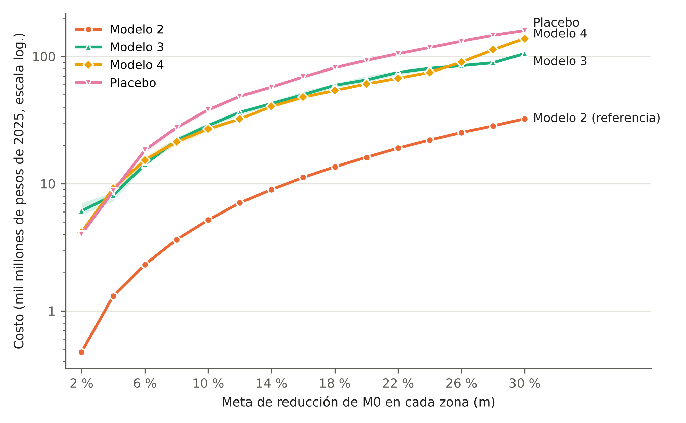
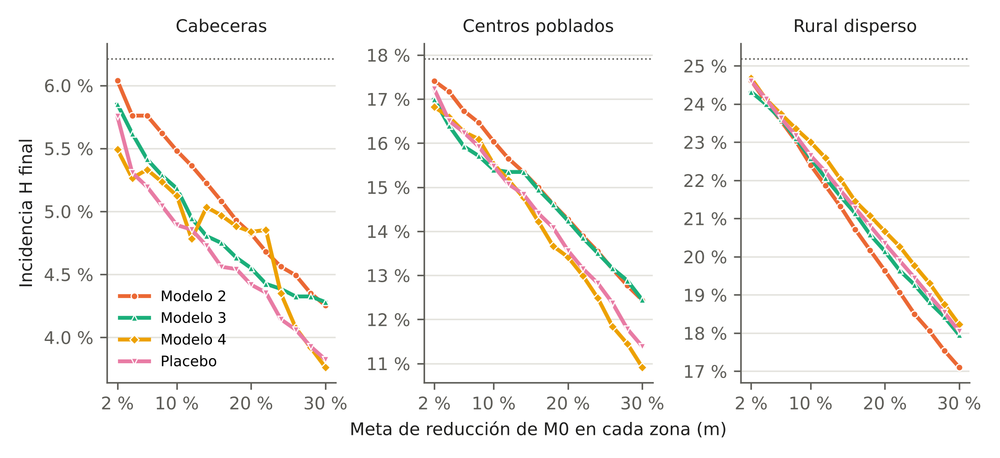
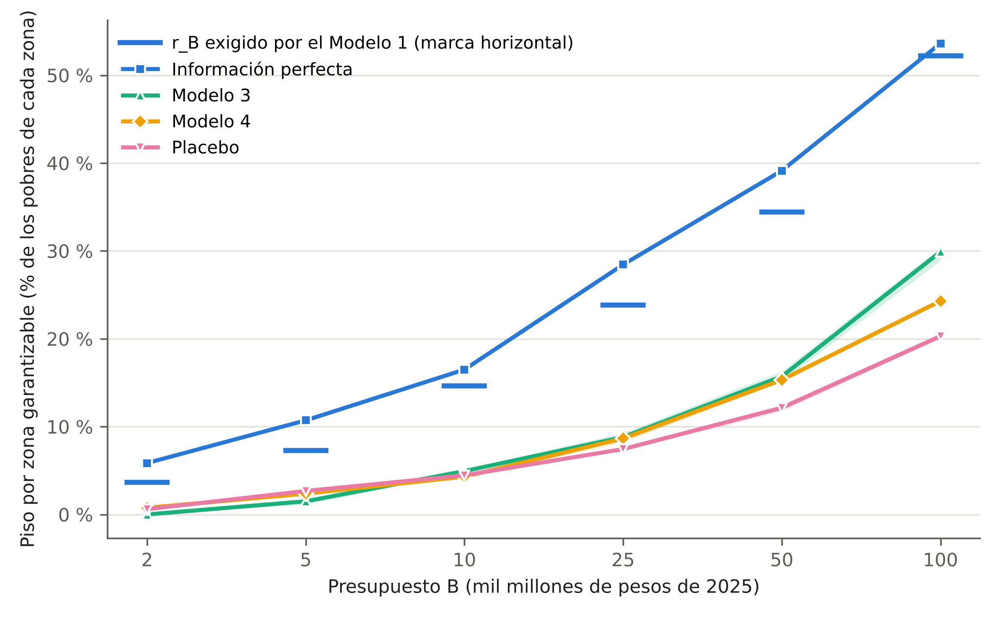

# Modelos 3 y 4 para el paper

Entrega de Jerónimo Vélez para integrar al borrador de Martín Quijano, según `PLAN_INTEGRACION_M3_M4.md` (rama `Contexto`, 14 de noviembre de 2026).

Cada bloque lleva el título de la sección del borrador donde se pega. Tablas, figuras y ecuaciones tienen numeración provisional (Tabla M34-1, Figura M34-1, ecuación M3.1). Todas las cifras del texto salen de los CSV de `datos_m34/`, y `cifras_m34.csv` indica para cada una el archivo y la columna de origen. Los valores de r_B, ρ_B y del Modelo 2 con meta por zona se tratan como provisionales hasta que Martín los confirme por escrito (sección 6 del plan).

---

## Resumen

Sin información individual, el Estado paga caro por focalizar. Con metas de reducción de M0 de hasta el 10 % en cada zona, focalizar solo por zona (Modelo 3) cuesta entre 5.5 y 12.9 veces lo que costaría con información perfecta, y focalizar por zona y tipo de hogar (Modelo 4) cuesta casi lo mismo. Con un presupuesto fijo, ninguna réplica del sorteo permite garantizar en cada zona la tasa mínima de salida que el Modelo 1 cumple con información perfecta.

---

## 1. Motivación

Los Modelos 1 y 2 suponen que el Estado sabe qué privaciones tiene cada hogar. Ningún programa social trabaja así: se asigna con estadísticas territoriales o con registros como el SISBÉN, y la ejecución llega a algunos hogares privados y no a otros. Por eso la pregunta de política no es solo cuánto cuesta reducir la pobreza, sino cuánto cuesta reducirla sin saber exactamente quién es pobre. Los Modelos 3 y 4 responden esa pregunta. El Estado decide cuánta cobertura comprar en cada zona o tipo de hogar, y un sorteo decide a qué hogares les llega. La diferencia de costo frente a los Modelos 1 y 2 es el precio de la información: lo máximo que valdría la pena invertir en mejorar los sistemas de focalización antes de ampliar el presupuesto de un programa.

---

## 2. Escenarios de política modelados

### Supuestos y salvedades propios de los Modelos 3 y 4

Los Modelos 3 y 4 comparten con los Modelos 1 y 2 los datos, los costos, las reglas de qué privación se puede quitar en un año y las restricciones de equidad territorial. Agregan tres supuestos propios.

1. **El sorteo R.** Cada par (hogar, indicador) recibe un número Rᵢⱼ uniforme entre 0 y 1, fijado antes de optimizar. El hogar sale de la privación si su número queda por debajo de la cobertura que el Estado compró en su celda. Así se representan los errores de focalización: dentro de una celda, cualquier hogar privado tiene la misma probabilidad de ser atendido, sea pobre o no.
2. **Las celdas de focalización.** Una celda es el grupo de hogares al que el Estado le puede asignar una cobertura distinta. En el Modelo 3 son las tres zonas de P3 (cabeceras, centros poblados y rural disperso). En el Modelo 4 son las zonas para los bienes públicos y cuatro tipos de hogar para los bienes privados. La base del IPM no identifica municipios, así que no hay celdas geográficas más finas.
3. **Las réplicas de Monte Carlo.** Como el resultado depende del sorteo, cada configuración se resuelve con muchos sorteos distintos (100 o 30, según el criterio) y se reporta la mediana con su intervalo. El Modelo 3, el Modelo 4 y el placebo usan el mismo sorteo en cada réplica, de modo que sus diferencias son pareadas.

Dos salvedades acompañan estos supuestos. Primero, como en el paper original, el modelo elige la cobertura conociendo el resultado del sorteo de esa réplica, lo que hace optimistas las cifras de los Modelos 3 y 4. Segundo, los sorteos de un mismo hogar son independientes entre indicadores; en la práctica, un hogar que no aparece en los registros suele quedar fuera de varios programas a la vez.

### Modelo 3

**Qué sabe el Estado.** Para cada zona y cada indicador, cuántas personas están privadas y cuánto cuesta atenderlas. No sabe quiénes son.

**Qué decide.** La cobertura θ(j, d) de cada par (indicador, zona): la fracción de la población privada de la zona que el programa va a atender. El sorteo decide qué hogares reciben esa cobertura.

**Qué se fija.** Los costos por hogar e indicador, las reglas de qué se puede quitar en un año, el sorteo de cada réplica y, según el criterio, la meta m de reducción de M0 en cada zona o el presupuesto B con la tasa mínima de salida r_B en cada zona.

### Modelo 4

**Qué sabe el Estado.** Lo mismo que en el Modelo 3 y, además, el tipo de hogar, construido con rasgos demográficos que registra el SISBÉN (tamaño, edades, jefatura). Sigue sin saber quién está privado en qué.

**Qué decide.** La cobertura de cada par (indicador, celda). Los dos bienes públicos (acueducto y alcantarillado) se focalizan por zona; los otros 13 indicadores, por tipo de hogar.

**Qué se fija.** Lo mismo que en el Modelo 3, más la partición en cuatro tipos de hogar (k = 4), que se calcula una vez y no cambia entre réplicas.

### Columnas de los Modelos 3 y 4 para la Tabla 1

> **Pendiente de alinear.** No tuve acceso al borrador de Martín, así que no conozco las 11 filas exactas de su Tabla 1. Las filas de abajo son las características que distinguen a los cuatro modelos. Al integrar, cada valor se pasa a la fila del borrador que corresponda.

| Característica | Modelo 3 | Modelo 4 |
|---|---|---|
| Información hogar por hogar | N. El Estado solo conoce agregados por zona. | N. Conoce agregados por zona y el tipo de hogar, no las privaciones. |
| Unidad de focalización | Parcial. Zona: 3 celdas para los 15 indicadores. | Parcial. Zona para los 2 bienes públicos y 4 tipos de hogar para los 13 privados. |
| Componente estocástico | S. El sorteo Rᵢⱼ decide qué hogares reciben la cobertura. | S. El mismo sorteo, con las mismas réplicas que el Modelo 3. |
| Errores de inclusión y exclusión | S. Se miden en cada réplica. | S. Se miden en cada réplica. |
| Meta de reducción de M0 en cada zona | S. Criterio de costo. | S. Criterio de costo. |
| Tasa mínima de salida por zona r | S. Criterio de presupuesto fijo, con el r_B del Modelo 1. | S. Igual que el Modelo 3. |
| Techo de severidad ρ | Parcial. Solo en la sensibilidad, con el ρ_B del Modelo 1. | Parcial. Igual que el Modelo 3. |
| Cobertura escolar obligatoria (E-7) | N. Exige saber qué niño no asiste; aquí lo decide el sorteo. | N. Igual que el Modelo 3. |
| Techo de severidad educativa (SevEdu) | N. Exige decisiones niño por niño. | N. Igual que el Modelo 3. |
| Privaciones que no se quitan en un año | S. Entran como constante en el puntaje, con las reglas del Modelo 1. | S. Igual que el Modelo 3. |
| Clustering demográfico | N. | S. k-medias sobre ocho rasgos, sin usar privaciones. |

---

## 3. Métodos empíricos

### Modelo 3: formulación

**Conjuntos.**

- I: los 3,732 hogares de Antioquia; I⁰ ⊆ I: los 523 hogares pobres de la línea base.
- J: los 15 indicadores del IPM.
- D: las tres zonas de P3; d(i) es la zona del hogar i.
- Para cada par (j, d), los hogares privados ordenados por su sorteo: R₍₁₎ < R₍₂₎ < … < R₍ₙ₎, con n = n(j, d).
- F(j, d): los cortes admisibles del par (j, d), definidos en la ecuación M3.8.

**Parámetros.**

- Mᵢⱼ ∈ {0, 1}: privación inicial; wⱼ: peso del indicador; k = 1/3: umbral de pobreza.
- pᵢ = HSᵢ · HWᵢ: personas que representa el hogar; cᵢ⁰ = Σⱼ wⱼ Mᵢⱼ: puntaje inicial.
- uᵢⱼ: personas del hogar que hay que atender para quitar la privación; eᵢⱼ: costo de quitarla en el hogar de la muestra.
- Vᵢⱼ = uᵢⱼ · HWᵢ: población que atiende el par; Kᵢⱼ = eᵢⱼ · HWᵢ: gasto que exige el par en la población.
- Den(j, d) = Σ_{i en d} Vᵢⱼ Mᵢⱼ: población privada en el indicador j dentro de la zona d.
- Rᵢⱼ ∈ [0, 1]: sorteo del par, distinto en cada réplica.
- m: meta de reducción de M0; B: presupuesto; r_B y ρ_B: los parámetros de equidad del Modelo 1 para ese presupuesto.

**Variables.**

- xᵢⱼ ∈ {0, 1}: 1 si se quita la privación j del hogar i.
- sᵢ: puntaje final del hogar.
- yᵢ ∈ {0, 1}: 1 si el hogar sale de la pobreza (en el código, b1ᵢ).
- Cᵢ ≥ 0: contribución del hogar al M0 final (solo en el criterio de costo).
- θ(j, d) ∈ [0, 1]: cobertura del par (indicador, zona).
- E(j, d) ≥ 0: gasto en el indicador j dentro de la zona d.

**Mecanismo de cobertura.** El gasto y la cobertura de cada par son

(M3.1) E(j, d) = Σ_{i en d} Kᵢⱼ · xᵢⱼ

(M3.2) θ(j, d) = (1 / Den(j, d)) · Σ_{i en d} Vᵢⱼ · xᵢⱼ

y el sorteo decide a quién llega la cobertura:

(M3.3) xᵢⱼ = Mᵢⱼ si Rᵢⱼ ≤ θ(j, d(i)), y xᵢⱼ = 0 si Rᵢⱼ > θ(j, d(i)).

Numerador y denominador de M3.2 se miden en la misma unidad, personas de la población. En el paper original el numerador está ponderado por HWᵢ y el denominador cuenta hogares de la muestra; con esa definición la cobertura llega a 4.81 en nuestros datos, todo hogar privado se cura y el Modelo 3 se reduce al Modelo 1 sin que el solver lo advierta.

**Función objetivo (criterio de costo).**

(M3.4) min Σⱼ Σ_d E(j, d)

**Restricciones (criterio de costo).** El puntaje final es

(M3.5) sᵢ = cᵢ⁰ − Σ_{j intervenible} wⱼ · xᵢⱼ

donde las privaciones que no se pueden quitar en un año quedan como constante. Para cada hogar pobre i ∈ I⁰, la censura de Alkire y Foster se linealiza con Big-M:

(M3.6a) Cᵢ + pᵢ · yᵢ ≥ pᵢ · sᵢ

(M3.6b) Cᵢ − pᵢ · yᵢ ≤ pᵢ · sᵢ

(M3.6c) sᵢ − (1 − yᵢ) ≤ 0.33

y la meta se exige en cada zona:

(M3.7) Σ_{i ∈ I⁰, d(i) = d} Cᵢ ≤ (1 − m) · Σ_{i ∈ I⁰, d(i) = d} pᵢ · cᵢ⁰ para cada zona d.

El lado derecho de M3.7 es la contribución inicial de la zona a M0, reducida en la meta; es la misma restricción (M-d) del Modelo 2. Las tres metas por zona implican la meta global, así que cumplir la meta en cada zona nunca cuesta menos que cumplirla en el total.

**Criterio de presupuesto fijo.** El mismo mecanismo admite el objetivo del Modelo 1. Se reemplazan M3.4, M3.6 y M3.7 por

max Σ_{i ∈ I⁰} pᵢ · yᵢ

sujeto a Σⱼ Σ_d E(j, d) ≤ B, a la condición de salida sᵢ ≤ 0.33 + (cᵢ⁰ − 0.33)(1 − yᵢ) y a la tasa mínima de salida en cada zona,

Σ_{i ∈ I⁰, d(i) = d} pᵢ · yᵢ ≥ r_B · Σ_{i ∈ I⁰, d(i) = d} pᵢ,

que es la restricción (4) del Modelo 1. En la sensibilidad se agrega el techo de severidad del Modelo 1, con las mismas tangentes: qᵢ ≥ 2a · sᵢ − a² para cada valor posible a, y Σᵢ pᵢ · qᵢ ≤ (1 − ρ_B) · Sev₀. Los empates se resuelven en una segunda etapa que minimiza la severidad, como en el Modelo 1.

**Reformulación exacta por cortes.** Escrito literalmente, con la linealización del Apéndice 1 del paper, el Modelo 3 no se resuelve: en una versión inicial con meta del 10 %, HiGHS no cerraba la brecha en más de 200 segundos. La razón también es la idea central del modelo. Como la cobertura θ(j, d) es un solo número para toda la zona, M3.3 cura exactamente a los hogares con Rᵢⱼ ≤ θ(j, d), y ese conjunto es siempre un prefijo del orden por R: si se cura el hogar en la posición c, se curan todos los anteriores. **El Estado elige cuántos hogares atiende, no cuáles.** La solución de cada par queda descrita por un corte c entre 0 y n. No todo corte es admisible, porque la cobertura que resulta de curar los c primeros tiene que curar a esos c y a ninguno más:

(M3.8) F(j, d) = { c : R₍c₎ ≤ θ(j, d)(c) ≤ R₍c₊₁₎ − ε }, con ε = 10⁻⁶,

donde θ(j, d)(c) es la cobertura de los c primeros. F(j, d) depende solo de los datos y del sorteo, así que se enumera antes de optimizar. Con una binaria z(j, d, c) por corte admisible, el modelo queda

(M3.9) min Σ_{(j, d)} Σ_{c ∈ F(j, d)} gasto(j, d, c) · z(j, d, c)

(M3.10) Σ_{c ∈ F(j, d)} z(j, d, c) = 1 para cada par (j, d)

(M3.11) xᵢⱼ = Σ_{c ∈ F(j, d(i)), c ≥ posición de i} z(j, d(i), c) para cada par privado (i, j)

más M3.5 a M3.7. Las dos formulaciones tienen las mismas soluciones factibles y el mismo gasto en cada una, así que tienen el mismo óptimo (Apéndice 1). En la base completa, la reformulación se resuelve en unos 2 segundos.

**Errores de focalización.** El error de inclusión es la fracción del gasto que llega a hogares que no eran pobres. El error de exclusión es la fracción de las personas pobres que no reciben ninguna intervención. Como el objetivo puede tener óptimos alternos con el mismo gasto y errores distintos, una segunda etapa elige, entre las soluciones con gasto a lo sumo E* · (1 + 10⁻⁶), la que menos gasta en hogares no pobres. Así el error reportado no depende del solver.

### Modelo 4: formulación

El Modelo 4 es el Modelo 3 con otra regla para asignar cada par a su celda:

(M4.1) g(i, j) = d(i) si j es un bien público, y g(i, j) = t(i) si j es un bien privado,

donde t(i) es el tipo del hogar. Los conjuntos, parámetros y variables son los del Modelo 3, con la celda g en lugar de la zona d. La función objetivo es

(M4.2) min Σ_{j privado} Σ_t E(j, t) + Σ_{j público} Σ_d E(j, d).

Las restricciones M3.5 a M3.7 no cambian, porque el puntaje sᵢ depende de todos los indicadores sin importar cómo se focalizó cada uno, y la meta y la tasa r_B se siguen exigiendo por zona de P3. La propiedad de prefijo solo usa que la cobertura es común dentro de una celda, así que la reformulación por cortes se aplica igual dentro de un tipo de hogar.

**Bienes públicos y privados.** Los bienes públicos son acueducto y alcantarillado, que se proveen con infraestructura y solo pueden focalizarse por territorio. Los otros 13 indicadores son bienes privados. Los datos apoyan la partición: el acueducto es 14.5 veces más frecuente en la zona más privada que en la menos privada, y solo 4.1 veces entre tipos de hogar. La inasistencia escolar y el hacinamiento varían mucho más entre tipos (51.7 y 26.6 veces) que entre zonas (4.8 y 2.7). El detalle está en el Apéndice 1.

**Tipos de hogar.** Se obtienen con k-medias sobre ocho rasgos que el Estado observa sin una encuesta de privaciones: número de personas, número de menores de 5 años, de personas de 5 a 17 y de mayores de 65, tasa de dependencia y edad, sexo y nivel educativo del jefe. Ninguna privación del IPM entra en el clustering: si entrara, el Estado usaría justo la información que el modelo supone que no tiene. Con k = 4 los tipos separan la pobreza sin haberla usado: la incidencia del tipo más pobre es 4.3 veces la del menos pobre.

**Placebo.** El Modelo 4 cambia dos cosas a la vez frente al Modelo 3: usa información demográfica y reparte los bienes privados en cuatro celdas en vez de tres. Una partición más fina focaliza mejor aunque no tenga contenido. Para separar los dos efectos se resuelve un placebo: el Modelo 4 con las etiquetas de tipo permutadas al azar entre los hogares. Conserva el número y el tamaño de las celdas, pero no la relación entre el tipo y las privaciones.

### Diseño de la comparación de los cuatro modelos

Los cuatro modelos solo pueden diferir en qué sabe el Estado. Todo lo demás es común: los mismos 3,732 hogares y la misma línea base (H₀ = 9.45 %, A₀ = 40.94 %, M₀ = 0.0387), una sola tabla de costos y de reglas de qué se puede quitar en un año, y las mismas restricciones de equidad territorial. En vez de quitarle al Modelo 1 sus restricciones de equidad, se las agregamos a los Modelos 3 y 4, que pueden representarlas porque solo dependen de cuántas personas salen o de cuánto baja M0 en cada zona.

**Qué entra y qué no.** La Tabla M34-1 dice qué restricciones tienen los cuatro modelos en la comparación y por qué.

**Tabla M34-1. Restricciones de la comparación de los cuatro modelos**

| Restricción | Modelos 1 y 2 en la comparación | Modelos 3 y 4 | Por qué |
|---|---|---|---|
| Cobertura escolar obligatoria (E-7) | No | No | Exige saber qué niño concreto no asiste |
| Techo de severidad educativa (SevEdu) | No | No | Exige decisiones niño por niño |
| Tasa mínima de salida por zona r | Sí, en el criterio de presupuesto | Sí, se agrega | Es lineal en yᵢ y no exige saber quién es quién |
| Techo de severidad ρ | Sí, como sensibilidad | Sí, como sensibilidad | Lineal con tangentes |
| Meta de M0 en cada zona | Sí, en el criterio de costo | Sí, reemplaza la meta global | Es la equidad territorial del Modelo 2 |

*Nota.* Especificación de la comparación de Martín (`ESPECIFICACION_COMPARACION_4_MODELOS.md`, rama `Contexto`, secciones 3.1 y 3.3). Los resultados propios de los Modelos 1 y 2, con E-7 y SevEdu, se reportan aparte.

**Los dos criterios.**

- **Criterio de costo.** ¿Cuánto cuesta reducir M0 un m % en cada zona? La referencia de información perfecta es el Modelo 2 sin E-7, con meta en cada zona. El precio de la información de un modelo X es E_X(m) / E_M2(m).
- **Criterio de presupuesto fijo.** ¿Cuántas personas salen de la pobreza con un presupuesto B, si en cada zona debe salir al menos una fracción r_B de los pobres? La referencia es el Modelo 1 sin E-7 ni SevEdu. El precio de la información es H_X(B) / H_M1(B).

**Las tres reglas.**

1. **Los mismos r y ρ en los cuatro modelos.** Para cada B, r_B y ρ_B se calculan una sola vez con el Modelo 1 de la comparación (r por el codo y ρ por la regla de la brecha) y se imponen iguales a los Modelos 3 y 4. Si cada modelo calibrara los suyos, la diferencia mediría parámetros distintos y no información.
2. **La infactibilidad es un resultado.** Para cada configuración se reporta la fracción de réplicas factibles, y las medianas se calculan sobre las factibles. Descartarlas en silencio sesgaría la muestra hacia los sorteos favorables.
3. **La misma tolerancia.** Brecha relativa de 10⁻⁶ en todas las etapas de todos los modelos.

**Réplicas.** En el criterio de costo, 100 réplicas por meta para el Modelo 3, el Modelo 4 y el placebo, todas con el mismo sorteo por réplica (4,500 corridas). En el criterio de presupuesto fijo, 100 réplicas con B ≤ $10 mil millones y 30 con B ≥ $25 mil millones (1,350 corridas), y 100 réplicas en el piso máximo garantizable (1,800 corridas). El número de réplicas se justifica con la condición del teorema del límite central de Hamie et al. (2024, ec. 8), n ≥ (1.96 · CV / e)², y se reporta el intervalo de confianza del 95 % de la mediana por bootstrap.

### Resolución y verificación

Todos los modelos se resuelven con HiGHS mediante PuLP, con brecha relativa de 10⁻⁶, y solo se cuentan las corridas con optimalidad demostrada. Las 4,500 corridas del criterio de costo terminaron todas con optimalidad demostrada. Las del criterio de presupuesto fijo con r_B son todas infactibles; para confirmar que la infactibilidad es real y no un error numérico, cada una se resolvió de nuevo sin el preprocesamiento del solver.

La prueba más exigente es la de granularidad máxima: si cada hogar es su propia celda, el sorteo no tiene a quién más asignar la cobertura y el Modelo 3 debe reproducir la información perfecta. Con las restricciones de equidad territorial pasan 11/11 pruebas (Tabla M34-11 del Apéndice 1). Con la meta en cada zona, el Modelo 3 reproduce el costo del Modelo 2 hasta el centavo con metas del 2 al 20 % y difiere en 0.38 % con la del 30 %. Con el piso r_B, saca exactamente a las mismas personas que el Modelo 1 con B ≤ $10 mil millones y difiere entre 0.32 % y 0.97 % con presupuestos mayores. La única diferencia es la ya declarada: el Modelo 1 puede usar un mismo ciclo de educación para adultos para quitar a la vez el logro y el analfabetismo de una persona, mientras que en los Modelos 3 y 4 cada par se costea por separado.

Una auditoría independiente del 14 de noviembre no encontró hallazgos críticos. Re-resolvió 144 soluciones y las verificó con la regla directa del sorteo (R ≤ θ) y con la meta en cada zona, sin violaciones. Comparó el modelo por cortes con la enumeración exhaustiva en 40 instancias pequeñas de cada criterio (40 de 40) y comprobó la frontera del piso máximo garantizable en 72 de 72 casos. Los errores que encontró eran de redacción y ya están corregidos.

---

## 4. Resultados principales

### Comparación de los cuatro modelos

Las cifras de esta sección son del escenario común, con las restricciones de equidad territorial de los Modelos 1 y 2 tal cual: meta de reducción de M0 en cada zona en el criterio de costo y tasa mínima de salida r_B en cada zona en el criterio de presupuesto fijo. El Modelo 1 no aparece en el criterio de costo porque fija el presupuesto y maximiza las personas que salen; su referencia está en el criterio de presupuesto fijo.

#### Criterio de costo

La Tabla M34-2 muestra el costo de cumplir cada meta. Se lee de izquierda a derecha como una escalera de información: el Modelo 2 sabe quién es pobre, el Modelo 4 conoce la zona y el tipo de hogar, el Modelo 3 solo la zona, y el placebo tiene la partición del Modelo 4 sin su contenido. El precio de la información es el cociente entre el costo de cada modelo y el del Modelo 2.

**Tabla M34-2. Costo de reducir M0 en cada zona, por modelo (mil millones de pesos de 2025)**

| Meta m | Modelo 2 | Modelo 3 | Modelo 4 | Placebo | Precio M3 | Precio M4 | M4/M3 (IC 95 %) | Réplicas con M4 < M3 | M4/placebo (IC 95 %) |
| --- | ---: | ---: | ---: | ---: | ---: | ---: | ---: | ---: | ---: |
| 2 % | 0.47 | 6.10 (3.6 a 13.2) | 4.15 (2.7 a 5.4) | 4.00 (2.7 a 5.7) | 12.9 | 8.8 | 0.64 (0.59 a 0.72) | 83 % | 1.00 (0.92 a 1.11) |
| 4 % | 1.31 | 8.09 (5.1 a 14.6) | 9.18 (6.5 a 11.0) | 8.72 (6.5 a 11.5) | 6.2 | 7.0 | 1.14 (0.98 a 1.25) | 42 % | 1.01 (0.95 a 1.05) |
| 6 % | 2.30 | 14.16 (9.7 a 30.6) | 15.34 (10.9 a 22.2) | 18.33 (12.7 a 26.7) | 6.1 | 6.7 | 1.04 (0.96 a 1.11) | 48 % | 0.83 (0.76 a 0.90) |
| 8 % | 3.62 | 21.96 (14.6 a 35.5) | 21.35 (16.0 a 26.9) | 27.62 (20.8 a 36.8) | 6.1 | 5.9 | 0.97 (0.88 a 1.02) | 54 % | 0.75 (0.72 a 0.79) |
| 10 % | 5.17 | 28.67 (20.2 a 38.6) | 26.91 (20.9 a 29.5) | 38.09 (29.0 a 49.1) | 5.5 | 5.2 | 0.90 (0.83 a 0.97) | 65 % | 0.70 (0.66 a 0.73) |
| 12 % | 7.06 | 36.39 (24.7 a 42.4) | 32.27 (27.7 a 35.5) | 48.62 (38.7 a 60.9) | 5.2 | 4.6 | 0.89 (0.87 a 0.92) | 71 % | 0.67 (0.65 a 0.69) |
| 14 % | 8.97 | 42.61 (30.6 a 73.4) | 40.44 (34.6 a 45.9) | 57.43 (48.3 a 72.1) | 4.8 | 4.5 | 0.96 (0.93 a 1.00) | 61 % | 0.69 (0.68 a 0.72) |
| 16 % | 11.19 | 50.07 (36.9 a 86.5) | 47.90 (39.9 a 52.6) | 69.07 (56.2 a 83.5) | 4.5 | 4.3 | 0.93 (0.87 a 0.97) | 64 % | 0.66 (0.65 a 0.69) |
| 18 % | 13.56 | 59.33 (45.4 a 89.1) | 53.95 (46.2 a 62.0) | 81.65 (66.2 a 93.1) | 4.4 | 4.0 | 0.92 (0.86 a 0.97) | 68 % | 0.66 (0.64 a 0.68) |
| 20 % | 16.11 | 65.41 (50.9 a 94.0) | 60.79 (54.1 a 68.2) | 93.33 (78.9 a 104.3) | 4.1 | 3.8 | 0.92 (0.87 a 0.97) | 70 % | 0.65 (0.64 a 0.67) |
| 22 % | 19.02 | 74.96 (59.8 a 97.6) | 67.38 (62.6 a 71.4) | 105.29 (87.8 a 116.6) | 3.9 | 3.5 | 0.90 (0.89 a 0.94) | 72 % | 0.64 (0.63 a 0.65) |
| 24 % | 22.04 | 80.65 (65.1 a 101.4) | 74.99 (70.9 a 77.4) | 117.73 (99.0 a 131.3) | 3.7 | 3.4 | 0.92 (0.90 a 0.95) | 68 % | 0.62 (0.62 a 0.64) |
| 26 % | 25.22 | 84.75 (70.7 a 105.4) | 90.29 (81.7 a 100.2) | 132.09 (110.9 a 145.1) | 3.4 | 3.6 | 1.07 (1.02 a 1.09) | 35 % | 0.68 (0.67 a 0.70) |
| 28 % | 28.46 | 89.28 (75.8 a 107.9) | 113.07 (97.9 a 125.3) | 146.91 (126.5 a 157.7) | 3.1 | 4.0 | 1.24 (1.20 a 1.29) | 4 % | 0.77 (0.76 a 0.78) |
| 30 % | 32.37 | 105.34 (89.5 a 125.8) | 138.61 (115.9 a 155.9) | 160.24 (140.0 a 173.5) | 3.3 | 4.3 | 1.30 (1.28 a 1.37) | 4 % | 0.86 (0.84 a 0.88) |

*Nota.* Modelo 2: información perfecta, una sola solución. Modelos 3 y 4 y placebo: mediana de 100 réplicas, y entre paréntesis los percentiles 5 y 95 entre réplicas. Precio: costo del modelo dividido por el del Modelo 2. M4/M3 y M4/placebo: mediana del cociente pareado réplica a réplica, con su intervalo de confianza del 95 % por bootstrap. Fuente: `datos_m34/costo_meta_zona.csv`.

**Figura M34-1. Costo de reducir M0 en cada zona según la información del Estado**

**Cómo se lee.** Cada línea es el costo de cumplir la meta del eje horizontal en las tres zonas a la vez. El eje vertical está en escala logarítmica, así que la distancia vertical entre dos líneas es el cociente de sus costos, es decir, el precio de la información. Las bandas son el intervalo de confianza del 95 % de la mediana.

**Qué se observa.** Con metas de hasta el 10 %, el Modelo 3 cuesta entre 5.5 y 12.9 veces lo que costaría con información perfecta, y con metas del 20 al 30 %, entre 3.1 y 4.1 veces. El Modelo 4 cuesta entre 3.4 y 8.8 veces la información perfecta y casi lo mismo que el Modelo 3. El placebo es el más caro desde la meta del 6 %.

**Interpretación.** La información vale más con metas modestas, que son las de los programas reales: elige a quién atender primero, y pierde valor cuando hay que atender a casi todos los pobres de todas formas.

*Fuente:* `datos_m34/costo_meta_zona.csv`.

Cuatro resultados se destacan.

**No saber quién es pobre es caro.** Con la meta del 6 %, por ejemplo, focalizar solo por zona cuesta $14.16 mil millones y con información perfecta $2.30 mil millones. Un sistema que permitiera identificar hogar por hogar a quién atender, como un registro social actualizado, pagaría su costo mientras costara menos que la diferencia, unos $12 mil millones para ese solo programa.

**Con la meta en cada zona, el tipo de hogar apenas mejora a la zona.** El intervalo del cociente M4/M3 queda por debajo de 1 en 9 de las 15 metas, contiene el 1 en 3 y queda por encima en 3. Con metas del 10 al 24 %, el Modelo 4 cuesta entre un 4 y 11 % menos que el Modelo 3, pero esas cifras son medianas: el Modelo 4 es más barato en entre el 61 y 72 % de las réplicas, no en todas. Con metas del 26 al 30 %, cuesta entre un 7 y 30 % más.

**Pero la demografía sí reemplaza a la geografía.** Desde la meta del 6 %, el Modelo 4 cuesta entre un 14 y 38 % menos que el placebo. La razón es que la meta se exige en cada zona. El Modelo 3 puede dirigir la cobertura al rural disperso, donde la incidencia es la más alta (25.2 %), y lo hace: desde la meta del 8 % pone allí entre el 65 y 79 % del gasto (Tabla M34-5). Las celdas del placebo mezclan las tres zonas, así que entre el 50 y 62 % de su gasto cae en las cabeceras, y para cumplir la meta rural tiene que comprar cobertura en todas partes. Los tipos del Modelo 4 también mezclan zonas, pero se relacionan con las privaciones, sobre todo con las educativas, y eso le permite llegar a los pobres sin saber dónde viven.

**Los errores de focalización son grandes.** Según la meta, la mediana del error de inclusión está entre el 26 y 55 % en el Modelo 3 y entre el 18 y 50 % en el Modelo 4. Entre el 56 y 93 % de las personas pobres no recibe ninguna intervención en el Modelo 3 (Tabla M34-6).

La Tabla M34-3 responde la pregunta de investigación, que es sobre la incidencia H. Aunque los Modelos 3 y 4 minimizan el costo de una meta sobre M0, la incidencia también baja en las tres zonas. Con la meta del 10 %, H pasa de 9.45 % a 8.38 % con información perfecta, a 8.15 % con el Modelo 3 y a 8.15 % con el Modelo 4.

**Tabla M34-3. Valores finales de H, A y M0 por zona con la meta del 10 %**

La tabla da, para el total de Antioquia y cada zona, el gasto y los valores inicial y final de la incidencia H, la intensidad A y M0. Para los Modelos 3 y 4 y el placebo, cada cifra es la mediana de las réplicas.

| Zona | Modelo | Gasto | H inicial | H final | A inicial | A final | M0 inicial | M0 final |
| --- | ---: | ---: | ---: | ---: | ---: | ---: | ---: | ---: |
| Total Antioquia | Modelo 2 | 5.17 | 9.45 % | 8.38 % | 40.94 % | 41.52 % | 0.0387 | 0.0348 |
| Total Antioquia | Modelo 3 | 28.67 | 9.45 % | 8.15 % | 40.94 % | 41.06 % | 0.0387 | 0.0334 |
| Total Antioquia | Modelo 4 | 26.91 | 9.45 % | 8.15 % | 40.94 % | 40.50 % | 0.0387 | 0.0331 |
| Total Antioquia | Placebo | 38.09 | 9.45 % | 7.89 % | 40.94 % | 40.97 % | 0.0387 | 0.0324 |
| Cabeceras | Modelo 2 | 0.38 | 6.21 % | 5.48 % | 40.58 % | 41.32 % | 0.0252 | 0.0227 |
| Cabeceras | Modelo 3 | 5.96 | 6.21 % | 5.18 % | 40.58 % | 40.87 % | 0.0252 | 0.0211 |
| Cabeceras | Modelo 4 | 10.07 | 6.21 % | 5.12 % | 40.58 % | 40.26 % | 0.0252 | 0.0207 |
| Cabeceras | Placebo | 19.78 | 6.21 % | 4.89 % | 40.58 % | 40.70 % | 0.0252 | 0.0198 |
| Centros poblados | Modelo 2 | 0.43 | 17.91 % | 16.04 % | 38.56 % | 38.60 % | 0.0691 | 0.0619 |
| Centros poblados | Modelo 3 | 1.37 | 17.91 % | 15.40 % | 38.56 % | 38.60 % | 0.0691 | 0.0595 |
| Centros poblados | Modelo 4 | 3.28 | 17.91 % | 15.52 % | 38.56 % | 38.34 % | 0.0691 | 0.0598 |
| Centros poblados | Placebo | 4.38 | 17.91 % | 15.48 % | 38.56 % | 38.56 % | 0.0691 | 0.0596 |
| Rural disperso | Modelo 2 | 4.37 | 25.18 % | 22.40 % | 42.11 % | 42.60 % | 0.1060 | 0.0954 |
| Rural disperso | Modelo 3 | 20.61 | 25.18 % | 22.58 % | 42.11 % | 42.11 % | 0.1060 | 0.0952 |
| Rural disperso | Modelo 4 | 13.47 | 25.18 % | 23.00 % | 42.11 % | 41.41 % | 0.1060 | 0.0954 |
| Rural disperso | Placebo | 14.29 | 25.18 % | 22.65 % | 42.11 % | 42.04 % | 0.1060 | 0.0954 |

*Nota.* Gasto en mil millones de pesos de 2025. M0 final cumple la meta en cada zona en todos los modelos; los Modelos 3 y 4 y el placebo la sobrepasan en algunas zonas. Fuente: `datos_m34/H_A_M0_por_zona.csv`, que trae también las otras 14 metas y los percentiles 5 y 95 de H.

En todas las metas y zonas, la incidencia baja al menos un 2.0 % en los Modelos 3 y 4 y el placebo. Con la misma meta, los Modelos 3 y 4 suelen bajar H tanto o más que el Modelo 2: el Modelo 3 deja una incidencia total menor o igual que la del Modelo 2 en 13 de las 15 metas, y el Modelo 4 en 12. No es una ventaja, es el reflejo del costo. Sin saber quién es pobre, la cobertura avanza a saltos y no se puede parar justo en la meta, así que en algunas zonas se reduce M0 más de lo exigido. Con la meta del 10 %, por ejemplo, el Modelo 3 reduce M0 un 16.2 % en las cabeceras, cuando la meta es del 10 %. El Modelo 2, en cambio, cumple la meta casi exactamente en cada zona y gasta lo mínimo. Por la misma razón, la intensidad A se comporta distinto: con información perfecta sube en 15 de las 15 metas, porque el Modelo 2 saca primero a los hogares más cerca del umbral y los que quedan son más intensamente pobres; en los Modelos 3 y 4 el sorteo no distingue esa cercanía, y A cambia poco o incluso baja. Con la meta del 30 %, H baja un 31.6 % con información perfecta, un 30.5 % con el Modelo 3 y un 34.9 % con el Modelo 4 (Tabla M34-4).

**Tabla M34-4. Valores finales de H, A y M0 por zona con la meta del 30 %**

| Zona | Modelo | Gasto | H inicial | H final | A inicial | A final | M0 inicial | M0 final |
| --- | ---: | ---: | ---: | ---: | ---: | ---: | ---: | ---: |
| Total Antioquia | Modelo 2 | 32.37 | 9.45 % | 6.46 % | 40.94 % | 41.86 % | 0.0387 | 0.0270 |
| Total Antioquia | Modelo 3 | 105.34 | 9.45 % | 6.57 % | 40.94 % | 40.56 % | 0.0387 | 0.0266 |
| Total Antioquia | Modelo 4 | 138.61 | 9.45 % | 6.15 % | 40.94 % | 39.68 % | 0.0387 | 0.0244 |
| Total Antioquia | Placebo | 160.24 | 9.45 % | 6.19 % | 40.94 % | 40.25 % | 0.0387 | 0.0249 |
| Cabeceras | Modelo 2 | 3.33 | 6.21 % | 4.25 % | 40.58 % | 41.39 % | 0.0252 | 0.0176 |
| Cabeceras | Modelo 3 | 16.50 | 6.21 % | 4.28 % | 40.58 % | 40.94 % | 0.0252 | 0.0175 |
| Cabeceras | Modelo 4 | 71.97 | 6.21 % | 3.76 % | 40.58 % | 39.11 % | 0.0252 | 0.0147 |
| Cabeceras | Placebo | 82.70 | 6.21 % | 3.82 % | 40.58 % | 39.87 % | 0.0252 | 0.0154 |
| Centros poblados | Modelo 2 | 3.91 | 17.91 % | 12.44 % | 38.56 % | 38.85 % | 0.0691 | 0.0483 |
| Centros poblados | Modelo 3 | 17.70 | 17.91 % | 12.44 % | 38.56 % | 38.10 % | 0.0691 | 0.0476 |
| Centros poblados | Modelo 4 | 15.81 | 17.91 % | 10.92 % | 38.56 % | 38.47 % | 0.0691 | 0.0421 |
| Centros poblados | Placebo | 19.49 | 17.91 % | 11.39 % | 38.56 % | 38.07 % | 0.0691 | 0.0437 |
| Rural disperso | Modelo 2 | 25.13 | 25.18 % | 17.10 % | 42.11 % | 43.40 % | 0.1060 | 0.0742 |
| Rural disperso | Modelo 3 | 68.35 | 25.18 % | 17.95 % | 42.11 % | 40.68 % | 0.1060 | 0.0734 |
| Rural disperso | Modelo 4 | 50.02 | 25.18 % | 18.23 % | 42.11 % | 40.68 % | 0.1060 | 0.0742 |
| Rural disperso | Placebo | 58.34 | 25.18 % | 18.04 % | 42.11 % | 41.10 % | 0.1060 | 0.0742 |

*Nota.* Igual que la Tabla M34-3. Fuente: `datos_m34/H_A_M0_por_zona.csv`.

**Figura M34-3. Incidencia final por zona según la meta**

**Cómo se lee.** Cada panel es una zona. Las líneas muestran la incidencia H final (mediana de las réplicas en los Modelos 3 y 4 y el placebo) para cada meta de reducción de M0. La línea punteada es la incidencia inicial de la zona.

**Qué se observa.** En las tres zonas, H baja con la meta en los cuatro modelos. En el rural disperso, que parte de la incidencia más alta (25.2 %), el Modelo 2 baja H más que los demás desde las metas intermedias. En las cabeceras y los centros poblados ocurre lo contrario: los Modelos 3 y 4 y el placebo bajan H igual o más que el Modelo 2.

**Interpretación.** En el rural disperso la meta obliga a los cuatro modelos a reducir M0 casi lo mismo, pero el Modelo 2 lo logra sacando de la pobreza a los hogares más cerca del umbral, así que con la misma reducción de M0 baja más la incidencia. En las otras zonas, los Modelos 3 y 4 sobrepasan la meta porque no pueden detener la cobertura justo donde haría falta. La información imperfecta no reduce menos la pobreza en total: la reduce de forma menos dirigida y mucho más cara.

*Fuente:* `datos_m34/H_A_M0_por_zona.csv`.

**Tabla M34-5. En qué se gasta: participación de la salud, la educación y dos zonas en el gasto (%)**

La tabla muestra, para algunas metas, qué parte del gasto va a cada dimensión y a cada zona. Explica por qué el placebo es caro con metas por zona.

| Meta m | Salud M3 | Educación M3 | Cabeceras M3 | Rural disperso M3 | Salud M4 | Educación M4 | Cabeceras M4 | Rural disperso M4 | Salud Plac. | Educación Plac. | Cabeceras Plac. | Rural disperso Plac. |
| --- | ---: | ---: | ---: | ---: | ---: | ---: | ---: | ---: | ---: | ---: | ---: | ---: |
| 2 % | 93 | 6 | 50 | 37 | 91 | 8 | 52 | 35 | 95 | 4 | 62 | 27 |
| 6 % | 75 | 22 | 34 | 59 | 46 | 53 | 46 | 43 | 51 | 46 | 52 | 36 |
| 10 % | 67 | 32 | 23 | 73 | 24 | 75 | 38 | 50 | 27 | 72 | 50 | 38 |
| 14 % | 48 | 49 | 18 | 79 | 20 | 79 | 43 | 45 | 18 | 81 | 50 | 38 |
| 20 % | 27 | 70 | 13 | 73 | 13 | 87 | 44 | 44 | 13 | 86 | 50 | 38 |
| 24 % | 27 | 72 | 12 | 71 | 14 | 86 | 45 | 43 | 10 | 89 | 50 | 38 |
| 30 % | 19 | 77 | 18 | 65 | 22 | 75 | 52 | 37 | 8 | 91 | 51 | 37 |

*Nota.* Promedio de la participación en las 100 réplicas. La salud incluye aseguramiento y barreras de acceso; los centros poblados completan el 100 % de las zonas. Ninguna corrida gasta más del 3 % en niñez, vivienda o trabajo. Fuente: `datos_m34/gasto_por_zona_y_dimension.csv`.

La meta por zona adelanta la entrada de la educación. Con la meta del 2 %, los tres modelos gastan al menos el 91 % en salud. Con la del 10 %, el Modelo 4 ya gasta el 75 % en educación, el placebo el 72 % y el Modelo 3 el 32 %.

**Tabla M34-6. Errores de focalización por meta**

La inclusión es la fracción del gasto que llega a hogares no pobres. La exclusión es la fracción de las personas pobres que no recibe ninguna intervención.

| Meta m | Inclusión M3 | Inclusión M4 | Inclusión placebo | Exclusión M3 | Exclusión M4 | Exclusión placebo |
| --- | ---: | ---: | ---: | ---: | ---: | ---: |
| 2 % | 54 % | 46 % | 55 % | 93 % | 91 % | 94 % |
| 4 % | 55 % | 50 % | 55 % | 90 % | 86 % | 87 % |
| 6 % | 44 % | 32 % | 44 % | 86 % | 85 % | 84 % |
| 8 % | 38 % | 25 % | 40 % | 84 % | 81 % | 81 % |
| 10 % | 37 % | 18 % | 38 % | 81 % | 78 % | 78 % |
| 12 % | 37 % | 23 % | 36 % | 78 % | 72 % | 76 % |
| 14 % | 33 % | 28 % | 37 % | 75 % | 74 % | 73 % |
| 16 % | 30 % | 30 % | 36 % | 71 % | 71 % | 70 % |
| 18 % | 28 % | 28 % | 35 % | 68 % | 68 % | 68 % |
| 20 % | 27 % | 27 % | 35 % | 66 % | 65 % | 65 % |
| 22 % | 28 % | 26 % | 35 % | 64 % | 63 % | 62 % |
| 24 % | 26 % | 28 % | 35 % | 62 % | 57 % | 59 % |
| 26 % | 27 % | 31 % | 35 % | 60 % | 53 % | 56 % |
| 28 % | 27 % | 35 % | 34 % | 59 % | 50 % | 53 % |
| 30 % | 27 % | 37 % | 35 % | 56 % | 47 % | 50 % |

*Nota.* Mediana de 100 réplicas. Fuente: `datos_m34/costo_meta_zona.csv`.

#### Criterio de presupuesto fijo

**Tabla M34-7. Factibilidad con la tasa mínima de salida del Modelo 1**

Para cada presupuesto, la tabla da r_B y ρ_B, las personas que saca de la pobreza el Modelo 1 con r_B y la fracción de réplicas en que los Modelos 3 y 4 y el placebo pueden cumplir r_B en las tres zonas.

| B | r_B | ρ_B | Salen con el Modelo 1 y r_B | Réplicas | Factibles con r_B (M3 / M4 / placebo) | Factibles con r_B y ρ_B |
| --- | ---: | ---: | ---: | ---: | ---: | ---: |
| 2 | 0.036 | no se alcanza | 87,034 | 100 | 0 % / 0 % / 0 % | no aplica |
| 5 | 0.073 | no se alcanza | 129,294 | 100 | 0 % / 0 % / 0 % | no aplica |
| 10 | 0.146 | no se alcanza | 154,347 | 100 | 0 % / 0 % / 0 % | no aplica |
| 25 | 0.238 | 0.165 | 214,879 | 30 | 0 % / 0 % / 0 % | 0 % / 0 % / 0 % |
| 50 | 0.344 | 0.215 | 281,588 | 30 | 0 % / 0 % / 0 % | 0 % / 0 % / 0 % |
| 100 | 0.522 | no se alcanza | 369,940 | 30 | 0 % / 0 % / 0 % | no aplica |

*Nota.* B en mil millones de pesos de 2025. r_B y ρ_B se calcularon con las funciones del Modelo 1 (r por el codo y ρ por la regla de la brecha); son provisionales hasta la confirmación de Martín. Con B = 2, 5, 10 y 100, la regla de la brecha no se alcanza y no hay ρ_B. Fuente: `datos_m34/factibilidad_cobertura_rB.csv` y `datos_m34/r_rho_referencias_M1.csv`.

Con información imperfecta, la tasa mínima de salida del Modelo 1 no se puede cumplir: en las 1,350 corridas, la fracción de réplicas factibles es del 0 % en todos los presupuestos. Lo reportamos como resultado. La razón cambia con el presupuesto. Con B ≥ $25 mil millones, r_B exige sacar a más personas de las que el Modelo 3 o el Modelo 4 logran sacar en total. Con B ≤ $10 mil millones el total sí alcanzaría, pero no su reparto: el sorteo no permite asegurar la fracción exigida en las tres zonas a la vez.

Para medir cuánta equidad territorial sí puede garantizar el Estado sin información individual, resolvimos en cada réplica el piso máximo garantizable,

r_max = max t sujeto a Σ_{i ∈ I⁰, d(i) = d} pᵢ · yᵢ ≥ t · Σ_{i ∈ I⁰, d(i) = d} pᵢ para cada zona d,

con el presupuesto B y el mismo mecanismo. Con información perfecta, r_max es el extremo superior del rango en el que el Modelo 1 busca el codo, y por eso siempre es al menos r_B.

**Tabla M34-8. Piso por zona máximo garantizable (% de los pobres de cada zona)**

| B | r_B (Modelo 1) | Información perfecta | Modelo 3 | Modelo 4 | Placebo | Mejor réplica M3 | M3 / IP | M4 / IP |
| --- | ---: | ---: | ---: | ---: | ---: | ---: | ---: | ---: |
| 2 | 3.6 % | 5.9 % | 0.0 % (0.0 a 0.1) | 0.8 % (0.7 a 0.9) | 0.6 % (0.4 a 0.8) | 1.6 % | 0 % | 13 % |
| 5 | 7.3 % | 10.7 % | 1.5 % (1.1 a 1.7) | 2.4 % (2.3 a 2.5) | 2.7 % (2.5 a 2.8) | 4.9 % | 14 % | 22 % |
| 10 | 14.6 % | 16.5 % | 4.9 % (4.8 a 5.1) | 4.3 % (4.2 a 4.4) | 4.5 % (4.4 a 4.5) | 8.3 % | 30 % | 26 % |
| 25 | 23.8 % | 28.4 % | 8.8 % (8.4 a 9.3) | 8.7 % (8.2 a 9.0) | 7.4 % (7.2 a 7.7) | 13.1 % | 31 % | 30 % |
| 50 | 34.4 % | 39.1 % | 15.7 % (15.1 a 16.3) | 15.3 % (15.1 a 15.7) | 12.1 % (11.7 a 12.5) | 20.8 % | 40 % | 39 % |
| 100 | 52.2 % | 53.6 % | 29.9 % (28.9 a 30.4) | 24.3 % (24.1 a 24.5) | 20.3 % (20.0 a 20.6) | 32.2 % | 56 % | 45 % |

*Nota.* B en mil millones de pesos de 2025. Información perfecta: un hogar por celda. Modelos 3 y 4 y placebo: mediana de 100 réplicas con su intervalo de confianza del 95 % por bootstrap. La última columna del Modelo 3 es su mejor réplica. Fuente: `datos_m34/rmax_piso_garantizable.csv`.

**Figura M34-2. Piso por zona garantizable según el presupuesto**

**Cómo se lee.** Para cada presupuesto, la figura muestra la mayor fracción de los pobres de cada zona que el Estado puede asegurar que sale de la pobreza en las tres zonas a la vez. Las marcas horizontales son el r_B que exige el Modelo 1.

**Qué se observa.** Con información perfecta el piso garantizable siempre supera a r_B. Sin información individual queda siempre por debajo: va de 0.0 % con B = $2 mil millones a 29.9 % con B = $100 mil millones en el Modelo 3, frente a 53.6 % con información perfecta. Ni la mejor réplica del Modelo 3 alcanza r_B en ningún presupuesto.

**Interpretación.** La falta de información no solo encarece la reducción de la pobreza: también limita cuánta equidad territorial puede prometer el Estado. Con B = $100 mil millones, los Modelos 3 y 4 garantizan entre el 45 y 56 % del piso que garantizaría la información perfecta.

*Fuente:* `datos_m34/rmax_piso_garantizable.csv`.

---

## 5. Discusión

El precio de la información se puede leer como lo máximo que valdría la pena invertir en información para un programa. Como la brecha relativa es mayor con metas modestas y presupuestos pequeños, el argumento pesa más para los programas acotados. El error de inclusión pide una lectura cuidadosa: que buena parte del gasto llegue a hogares no pobres no significa que se pierda, porque esos hogares sí tenían la privación que se les quita. Lo que se pierde es eficacia frente al objetivo de reducir la pobreza multidimensional. Un programa evaluado por su cobertura puede verse exitoso y mover poco el IPM.

El Modelo 4 y su placebo separan dos fuentes de mejora que en la práctica se confunden: la granularidad, que ayuda aunque las celdas no signifiquen nada, y el contenido de la partición, que solo ayuda si se relaciona con la privación. Con metas por zona, la granularidad sin contenido estorba, porque las celdas al azar mezclan las zonas. Antes de focalizar un programa por tipo de hogar hay que comprobar que esos tipos discriminan la privación que el programa ataca.

**Limitaciones de los Modelos 3 y 4.** La base del IPM no identifica municipios, así que la focalización geográfica solo distingue tres zonas; con celdas municipales el Modelo 3 se acercaría a la información perfecta, y nuestro precio de la información es una cota superior. El sorteo supone que, dentro de una celda, cualquier hogar privado tiene la misma probabilidad de ser atendido, y que los sorteos de un hogar son independientes entre indicadores. El modelo elige la cobertura conociendo el sorteo de cada réplica, como en el paper original, así que las cifras son optimistas. Los dos sesgos van en sentidos opuestos: las celdas gruesas inflan el precio de la información y conocer el sorteo lo reduce. Algunas celdas tienen menos de 10 hogares privados en la muestra, y en ellas la cobertura avanza a saltos. La severidad que se reporta, como en el Modelo 1, no está censurada.

---

## Apéndice 1. Linealización y parámetros de los Modelos 3 y 4

### Censura de Alkire y Foster

Hamie et al. (2024, Apéndice 1) linealizan la censura con dos binarias por hogar y cinco restricciones (Lin 1 a Lin 5). En los Modelos 3 y 4 bastan Lin 1 a Lin 3, escritas como M3.6a a M3.6c, con Big-M igual a pᵢ en las dos primeras e igual a 1 en la tercera, y con sᵢ < k escrito como sᵢ ≤ 0.33. La conversión es exacta porque todos los pesos son múltiplos de 0.01. Omitir Lin 4 y Lin 5 no cambia el óptimo: si se toma una solución factible sin ellas y se redefine yᵢ como 1 exactamente cuando sᵢ < k, la contribución Cᵢ no aumenta, la meta se sigue cumpliendo y el gasto es el mismo. El Big-M pᵢ es el más ajustado posible, porque sᵢ ≤ 1; con una constante global la relajación lineal se afloja y el solver no cierra la brecha. La cota Cᵢ ≥ 0 es indispensable: sin ella la meta se cumple con contribuciones negativas.

### Mecanismo de cobertura

Para cada par privado, el paper introduce dos binarias y escribe M3.3 como Lin 6 a Lin 10. La verificamos rama por rama: si la primera binaria vale 0, el hogar sale de la privación y Rᵢⱼ ≤ θ; si vale 1, sigue privado y θ ≤ Rᵢⱼ − ε. Las dos ramas cubren todos los casos sin solaparse. Como todas las cantidades están entre 0 y 1, basta Big-M igual a 1, y con ese valor la binaria coincide con xᵢⱼ, así que las dos binarias se eliminan. La desigualdad estricta θ < R se escribe θ ≤ R − ε con ε = 10⁻⁶, el mismo valor de M3.8: si cambia uno, tiene que cambiar el otro.

### Equivalencia de la reformulación por cortes

Tomemos una solución factible de la formulación directa y un par (j, d). Por M3.3, los hogares curados son los que tienen Rᵢⱼ ≤ θ(j, d), un prefijo del orden de tamaño c. Por M3.2, θ(j, d) es la cobertura de esos c primeros. El último curado cumple R₍c₎ ≤ θ y el primero no curado cumple θ ≤ R₍c₊₁₎ − ε, así que c pertenece a F(j, d), y con z(j, d, c) = 1 la ecuación M3.11 reproduce las mismas xᵢⱼ con el mismo gasto. Recíprocamente, si c pertenece a F(j, d), curar los c primeros y fijar θ como su cobertura cumple M3.2 y M3.3 por la definición de F(j, d). Las restricciones M3.5 a M3.7 dependen solo de xᵢⱼ, así que se cumplen en las dos formulaciones a la vez.

### Tangentes de la severidad

En el criterio de presupuesto fijo, la severidad qᵢ = sᵢ² se representa, como en el Modelo 1, con una tangente por cada valor posible a del puntaje: qᵢ ≥ 2a · sᵢ − a². Como sᵢ solo toma valores discretos, el máximo de las tangentes coincide con sᵢ² en esos valores. La implementación omite la tangente en a = 0, que es redundante con qᵢ ≥ 0.

### Parámetros del Modelo 4

**Tabla M34-9. Razón entre la incidencia de la privación en la celda más privada y en la menos privada**

La tabla compara qué tanto varía cada privación entre zonas y entre tipos de hogar. Una razón alta significa que la partición discrimina bien esa privación.

| Privación | Entre zonas | Entre tipos de hogar |
| --- | ---: | ---: |
| Acueducto (bien público) | 14.5 | 4.1 |
| Alcantarillado (bien público) | 4.7 | 3.2 |
| Inasistencia escolar | 4.8 | 51.7 |
| Hacinamiento | 2.7 | 26.6 |
| Atención integral a la primera infancia | 2.2 | solo existe en hogares con niños |
| Aseguramiento en salud | 1.9 | 1.9 |
| Barreras de acceso a salud | 2.7 | 1.8 |

*Nota.* Personas expandidas, k = 4. La atención integral a la primera infancia solo puede existir en hogares con niños menores de 5 años. Fuente: `datos_m34/discriminacion_privaciones.csv`.

**Tabla M34-10. Tipos de hogar del Modelo 4 (k = 4)**

| Tipo de hogar | Hogares en la muestra | Incidencia H |
| --- | ---: | ---: |
| Adultos sin dependientes | 1,389 | 3.7 % |
| Adultos mayores | 1,038 | 11.8 % |
| Con hijos escolares | 849 | 9.1 % |
| Primera infancia | 456 | 16.1 % |

*Nota.* k-medias ponderado por el factor de expansión, semilla fija. Fuente: `datos_m34/tipos_hogar.csv`.

### Validación de granularidad máxima

**Tabla M34-11. Modelo 3 con un hogar por celda frente a la información perfecta**

G1 compara el costo con meta en cada zona contra el Modelo 2 (mil millones de pesos de 2025). G2 compara las personas que salen con r_B contra el Modelo 1.

| Prueba | Modelo 3 con un hogar por celda | Información perfecta | Diferencia | Resultado |
| --- | ---: | ---: | ---: | ---: |
| G1 meta por zona 2 % | 0.47 | 0.47 | 0.00 % | pasa |
| G1 meta por zona 6 % | 2.30 | 2.30 | 0.00 % | pasa |
| G1 meta por zona 10 % | 5.17 | 5.17 | 0.00 % | pasa |
| G1 meta por zona 20 % | 16.11 | 16.11 | 0.00 % | pasa |
| G1 meta por zona 30 % | 32.49 | 32.37 | 0.38 % | pasa |
| G2 piso por zona r_B, B = 2 | 87,034 | 87,034 | 0.00 % | pasa |
| G2 piso por zona r_B, B = 5 | 129,294 | 129,294 | 0.00 % | pasa |
| G2 piso por zona r_B, B = 10 | 154,347 | 154,347 | 0.00 % | pasa |
| G2 piso por zona r_B, B = 25 | 212,791 | 214,879 | -0.97 % | pasa |
| G2 piso por zona r_B, B = 50 | 279,498 | 281,588 | -0.74 % | pasa |
| G2 piso por zona r_B, B = 100 | 368,751 | 369,940 | -0.32 % | pasa |

*Nota.* La diferencia admitida es la del ciclo de educación para adultos. Fuente: `datos_m34/validacion_granularidad_maxima.csv`.

---

## Apéndice 2. Sensibilidades de los Modelos 3 y 4

### Sin equidad territorial: meta global y r = 0

Como sensibilidad, repetimos la comparación sin restricciones de equidad territorial: con la meta de M0 global y con r = 0. Miden cuánto cuesta la equidad territorial en cada modelo. Con la meta global del 10 %, la información perfecta cuesta $1.32 mil millones, y con la misma meta en cada zona, $5.17 mil millones. Con meta global, el Modelo 3 cuesta entre 6.2 y 16.9 veces la información perfecta con metas de hasta el 10 %. El Modelo 4 es más barato que el Modelo 3, pero hasta la meta del 18 % cuesta lo mismo que el placebo: sin la exigencia por zona, cualquier partición más fina ayuda.

**Tabla M34-12. Costo de reducir M0 con una meta global (mil millones de pesos de 2025)**

| Meta m | Modelo 2 | Modelo 3 | Modelo 4 | Placebo | Precio M3 | Precio M4 | M4/placebo (IC 95 %) |
| --- | ---: | ---: | ---: | ---: | ---: | ---: | ---: |
| 2 % | 0.18 | 2.22 | 1.57 | 1.58 | 12.0 | 8.5 | 1.11 (0.94 a 1.25) |
| 6 % | 0.51 | 5.66 | 3.24 | 3.44 | 11.2 | 6.4 | 0.90 (0.85 a 0.95) |
| 10 % | 1.32 | 8.27 | 6.16 | 6.01 | 6.2 | 4.7 | 1.02 (0.98 a 1.08) |
| 14 % | 2.37 | 10.12 | 9.25 | 9.17 | 4.3 | 3.9 | 1.01 (0.98 a 1.04) |
| 18 % | 4.26 | 14.22 | 14.18 | 13.69 | 3.3 | 3.3 | 1.04 (1.00 a 1.06) |
| 20 % | 6.47 | 22.83 | 20.73 | 21.75 | 3.5 | 3.2 | 0.93 (0.89 a 0.96) |
| 24 % | 12.49 | 48.74 | 34.48 | 45.16 | 3.9 | 2.8 | 0.75 (0.72 a 0.77) |
| 30 % | 24.40 | 84.36 | 61.08 | 82.77 | 3.5 | 2.5 | 0.74 (0.72 a 0.76) |

*Nota.* Mediana de 100 réplicas. Datos congelados del 10 de noviembre. Fuente: `datos_m34/sens_meta_global_costos.csv`.

**Tabla M34-13. Personas que salen de la pobreza con r = 0**

Esta tabla permite comparar H en los cuatro modelos, porque sin piso por zona los Modelos 3 y 4 sí son factibles.

| B | Réplicas | Modelo 1 | Modelo 3 | Modelo 4 | Placebo | M3 / M1 | M4 / M1 | M4/M3 (IC 95 %) |
| --- | ---: | ---: | ---: | ---: | ---: | ---: | ---: | ---: |
| 2 | 100 | 97,286 | 12,424 | 18,173 | 19,805 | 13 % | 19 % | 1.14 (0.96 a 1.22) |
| 5 | 100 | 135,908 | 33,736 | 61,269 | 63,457 | 25 % | 45 % | 1.86 (1.64 a 2.04) |
| 10 | 100 | 161,254 | 95,607 | 103,679 | 105,663 | 59 % | 64 % | 1.10 (1.04 a 1.30) |
| 25 | 30 | 217,910 | 141,688 | 146,118 | 144,737 | 65 % | 67 % | 1.03 (1.02 a 1.04) |
| 50 | 30 | 284,099 | 166,850 | 186,268 | 170,098 | 59 % | 66 % | 1.12 (1.11 a 1.12) |
| 100 | 30 | 370,508 | 218,204 | 242,657 | 222,610 | 59 % | 65 % | 1.11 (1.10 a 1.12) |

*Nota.* B en mil millones de pesos de 2025. Modelo 1 con r = 0, sin E-7 ni SevEdu. Mediana de las réplicas, con su intervalo de confianza del 95 % para el cociente pareado. Datos congelados del 10 de noviembre. Fuente: `datos_m34/sens_r0_personas_que_salen.csv` y `datos_m34/sens_r0_info_perfecta_M1.csv`.

Con r = 0, el Modelo 3 saca de la pobreza entre el 13 y 65 % de las personas que saldrían con el Modelo 1, y el Modelo 4 entre el 19 y 67 %.

### Número de tipos de hogar k y costos simplificados (u = 1)

La elección de k se apoyó en un análisis con 50 réplicas pareadas para k de 2 a 8, hecho con una versión simplificada de los costos (una intervención por hogar, uᵢⱼ = 1) y sin equidad territorial, así que se lee por su forma y no por sus cifras. Con k = 2, el Modelo 4 saca de la pobreza 0.71 veces las personas del Modelo 3: la partición separa los hogares por tamaño, que casi no se relaciona con la pobreza. De k = 3 a k = 4 la ganancia es grande, y desde ahí se aplana (1.92 veces con k = 4 y 1.93 con k = 5). Con k = 8 hay celdas con menos de 10 hogares privados, donde el sorteo deja de representar una focalización por tipo. Elegimos k = 4 con dos criterios: que menos del 15 % de los pares (indicador, celda) tenga menos de 10 hogares privados, y que al pasar a k + 1 la ganancia sea marginal.

**Tabla M34-14. Personas que salen con B = $10 mil millones según el número de tipos de hogar**

| Partición del Modelo 4 | Personas que salen con B = 10 | Veces el Modelo 3 (mediana) |
| --- | ---: | ---: |
| Modelo 3 | 31,066 | 1.00 |
| k = 2 | 21,836 | 0.71 |
| k = 3 | 44,626 | 1.19 |
| k = 4 (caso base) | 61,232 | 1.92 |
| k = 5 | 61,427 | 1.93 |
| k = 6 | 64,677 | 1.99 |
| k = 8 | 76,248 | 2.44 |

*Nota.* Costos simplificados (uᵢⱼ = 1), sin equidad territorial, 50 réplicas pareadas. Fuente: `datos_m34/sens_k_u1.csv`.

---

## Referencias

- Alkire, S., y Foster, J. (2011). Counting and multidimensional poverty measurement. *Journal of Public Economics*, 95(7-8), 476-487. https://doi.org/10.1016/j.jpubeco.2010.11.006
- DANE (2026). *Medida de Pobreza Multidimensional 2025: microdatos departamentales* (catálogo 903). Departamento Administrativo Nacional de Estadística. https://microdatos.dane.gov.co/index.php/catalog/903
- Hamie, C., Hlasny, V., y Jouni, M. (2024). *Multidimensional poverty alleviation: Policy optimization and impact simulation* (Working Paper 1742). Economic Research Forum. https://erf.org.eg/publications/multidimensional-poverty-alleviation-policy-optimization-and-impact-simulation/
- Huangfu, Q., y Hall, J. A. J. (2018). Parallelizing the dual revised simplex method. *Mathematical Programming Computation*, 10(1), 119-142. https://doi.org/10.1007/s12532-017-0130-5
- Mitchell, S., O'Sullivan, M., y Dunning, I. (2011). PuLP: A linear programming toolkit for Python. University of Auckland. https://optimization-online.org/2011/09/3178/
- Pedregosa, F., et al. (2011). Scikit-learn: Machine learning in Python. *Journal of Machine Learning Research*, 12, 2825-2830. https://jmlr.org/papers/v12/pedregosa11a.html
