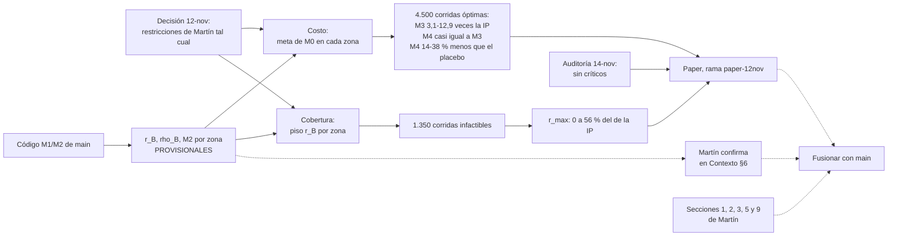

# Graph Report - Comparación de los 4 modelos, 12 a 14 de noviembre (M3/M4, Jerónimo)

> Grafo construido a mano en formato graphify (node-link JSON, mismas claves que `graphify-out/graph.json`; el JSON es `graph.json`, en esta misma carpeta). Resume la conversación de Jerónimo con Claude del 12 al 14 de noviembre para que Martín, o su Claude, pueda continuar sin leerla.

## Contexto en 60 segundos (léelo primero)

- **Decisión del 12-nov:** M3 y M4 usan las restricciones de equidad de Martín tal cual. Costo: meta de M0 **en cada zona**, contra el M2 con la misma meta. Cobertura: piso **r_B** por zona, contra el M1. Los datos del 10-nov (meta global, r = 0) quedan como sensibilidad.
- **Las referencias de información perfecta son provisionales.** Jerónimo calculó r_B, ρ_B y el costo del M2 por zona con las funciones de Martín de `main` (`bb51532`), sin cambiarlas. **Martín debe confirmarlas** (ver "Lo que le toca a Martín").
- **Corridas (rama `Modelo3`, commit `a88de3c`):** 4.500 de costo, todas óptimas; 1.350 de cobertura con r_B, todas infactibles; 1.800 del piso máximo garantizable r_max.
- **Resultados:**
  - M3 cuesta entre 3,1 y 12,9 veces lo que cuesta con información perfecta (5,5 a 12,9 con metas de hasta el 10 %); M4 entre 3,4 y 8,8.
  - M4 cuesta casi lo mismo que M3: 4–11 % menos con metas del 10 al 24 %, igual con las del 4 al 8 %, más con las del 26 al 30 %.
  - M4 cuesta 14–38 % menos que un placebo con su misma partición. Con metas por zona, una partición sin contenido estorba.
  - Con r_B, M3 y M4 son infactibles en todas las réplicas. El piso que sí garantizan va de 0 (B = 2) al 45–56 % del de la información perfecta (B = 100).
- **Validación:** con un hogar por celda, M3 reproduce el M2 por zona y el M1 con r_B (11/11), salvo la desviación declarada del ciclo CLEI (≤ 0,38 % en costo, ≤ 0,97 % en personas).
- **Auditoría del 14-nov:** sin hallazgos críticos. 144 soluciones verificadas con la regla directa del sorteo, fuerza bruta 40/40, frontera de r_max 72/72. Los errores de redacción del paper ya están corregidos.
- **Paper:** rama `paper-12nov` (commit `049a1ee`), 21 páginas, compila. **No está en `main`:** espera la confirmación de Martín.

## Lo que le toca a Martín

1. **Responder la sección 6 de `RESPUESTA_JERONIMO_12NOV.md`** (rama `Contexto`), en ese mismo archivo y con push. Son tres preguntas:
   - ¿Con tu código te dan estos mismos valores?

     | B (mm) | r_B | ρ_B | Personas que salen con el M1 y r_B |
     |---|---|---|---|
     | 2 | 0,0365 | no se alcanza | 87.034 |
     | 5 | 0,0730 | no se alcanza | 129.294 |
     | 10 | 0,1462 | no se alcanza | 154.347 |
     | 25 | 0,2382 | 0,1646 | 214.879 |
     | 50 | 0,3442 | 0,2152 | 281.588 |
     | 100 | 0,5219 | no se alcanza | 369.940 |

     Costo del M2 sin E-7 con meta por zona (mm): 0,47 (2 %), 2,30 (6 %), 5,17 (10 %), 16,11 (20 %), 32,37 (30 %). M1 sin E-7 ni SevEdu, r por el codo, ρ por la regla de la brecha, brecha del solver 10⁻⁶.
   - ¿Estás de acuerdo con que el paper use esos valores?
   - ¿Quieres cambiar algo de la reescritura de las secciones 8 y 10 a 13?
2. **Escribir sus secciones del paper:** 1, 2, 3, 5 y 9, más una frase en el resumen y una o dos conclusiones de M1/M2. Hay 16 marcas `\pendiente`. El texto de M3/M4 cita "la restricción (4) del Modelo 1", que debe quedar escrita en la sección 5.
3. **Avisar cuando confirme,** para fusionar `paper-12nov` con `main`.

Si algún valor cambia: el costo solo cambia en la columna de información perfecta (no hay que repetir M3/M4); la cobertura y r_max sí hay que repetirlos, unos 15 minutos.

## Cómo continuar

```bash
git fetch origin
git checkout paper-12nov          # paper; compilar con latexmk -pdf main.tex dentro de paper/
git checkout Modelo3              # código y resultados de M3/M4 (resultados/m34/*_12nov.csv)
# reproducir las referencias con el código de main:
python3 m34_referencias_comparacion.py <ruta a Modelos/ de main> out12/ref
# comprobar las cifras del paper contra los datos:
python3 m34_verificar_12nov.py <ruta a paper/cifras.tex>          # 16/16
python3 m34_verificar_cifras_paper.py <ruta a paper/cifras.tex>   # 29/29
```

Reglas del paper: los números salen de `cifras.tex` y de `tablas/*.tex`, que se generan desde los CSV; no se escriben a mano.

## Mapa



## Summary
- 40 nodes · 62 edges · 7 communities · 0 hyperedges
- Extraction: 100% EXTRACTED · construido manualmente

## Nodos por comunidad

### Comunidad 0 — Decisiones del 12-nov

| Nodo | Qué es | Dónde está |
|---|---|---|
| `d_restricciones` | Decisión: usar las restricciones de equidad de Martín tal cual en los 4 modelos | `Contexto/RESPUESTA_JERONIMO_12NOV.md` |
| `d_costo_zona` | Criterio de costo: meta de M0 en cada zona, M3/M4 contra el M2 con la misma meta | `Contexto/ESPECIFICACION_COMPARACION_4_MODELOS.md §4.3` |
| `d_cobertura_rb` | Criterio de cobertura: piso r_B por zona (y r_B + rho_B como sensibilidad), M3/M4 contra el M1 | `Contexto/ESPECIFICACION_COMPARACION_4_MODELOS.md §4.1-4.2` |
| `d_sensibilidad` | Los datos del 10-nov (meta global, r = 0) quedan como sensibilidad | `paper/secciones/10_resultados_3_4.tex` |
| `d_no_merge` | paper-12nov NO se fusiona con main hasta que Martín confirme | `Contexto/RESPUESTA_JERONIMO_12NOV.md §6` |

### Comunidad 1 — Referencias de información perfecta (código de Martín)

| Nodo | Qué es | Dónde está |
|---|---|---|
| `ref_codigo` | Código de M1/M2 de Martín en main (bb51532, 10-nov), usado sin cambios | `main:Modelos/` |
| `ref_script` | m34_referencias_comparacion.py + m34_compat_martin.py: calculan las referencias con las funciones de Martín | `Modelo3:m34_referencias_comparacion.py` |
| `ref_rrho` | r_B y rho_B por presupuesto: B=2: 0,0365 | 5: 0,0730 | 10: 0,1462 | 25: 0,2382 (rho 0,1646) | 50: 0,3442 (rho 0,2152) | 100: 0,5219. PROVISIONALES | `Modelo3:resultados/m34/r_rho_comparacion_12nov.csv` |
| `ref_m2zona` | Costo del M2 sin E-7 con meta por zona (mm): 2 %: 0,47 | 6 %: 2,30 | 10 %: 5,17 | 20 %: 16,11 | 30 %: 32,37. PROVISIONAL | `Modelo3:resultados/m34/info_perfecta_meta_zona_12nov.csv` |
| `ref_m1techo` | Personas que salen con el M1 y r_B: 87.034 / 129.294 / 154.347 / 214.879 / 281.588 / 369.940 | `Modelo3:resultados/m34/r_rho_comparacion_12nov.csv` |

### Comunidad 2 — Corridas de M3/M4

| Nodo | Qué es | Dónde está |
|---|---|---|
| `c_mecanismo` | resolver_paper(zona=...): meta por zona  sum_{i en I0, d} C_i <= (1-m) sum_{i en I0, d} p_i s_i^0 | `Modelo3:m34_mecanismo.py` |
| `c_equidad` | m34_equidad.py: max personas con presupuesto B, piso (4) y techo de severidad (8) | `Modelo3:m34_equidad.py` |
| `c_script` | m34_comparacion_12nov.py: corridas de costo y cobertura, M3/M4/placebo pareados, se puede retomar | `Modelo3:m34_comparacion_12nov.py` |
| `c_costo` | 4.500 corridas de costo (100 réplicas x 15 metas x 3 modelos), todas óptimas | `Modelo3:resultados/m34/costo_meta_zona_crudo_12nov.csv` |
| `c_cobertura` | 1.350 corridas de cobertura con r_B: todas infactibles (1.170 con r_B, 180 con r_B + rho_B) | `Modelo3:resultados/m34/cobertura_rB_crudo_12nov.csv` |
| `c_rmax` | 1.800 corridas del piso máximo garantizable r_max (max t con piso t en cada zona) | `Modelo3:m34_rmax_12nov.py, resultados/m34/rmax_12nov.csv` |

### Comunidad 3 — Resultados

| Nodo | Qué es | Dónde está |
|---|---|---|
| `r_precio` | Precio de la información: M3 cuesta 3,1-12,9 veces la IP (5,5-12,9 con metas <= 10 %); M4 3,4-8,8 | `Modelo3:resultados/m34/ic_costo_meta_zona_12nov.csv` |
| `r_m4m3` | M4 contra M3: más barato en 9 metas (2 % y 10-24 %, 4-11 % menos), igual en 3 (4-8 %), más caro en 3 (26-30 %) | `ic_costo_meta_zona_12nov.csv` |
| `r_placebo` | M4 cuesta 14-38 % menos que el placebo desde la meta del 6 %: la demografía reemplaza a la geografía | `ic_costo_meta_zona_12nov.csv` |
| `r_rural` | M3 pone 65-79 % del gasto en la zona rural; el placebo ~50 % en la cabecera | `paper/tablas/gasto_zona.tex` |
| `r_errores` | Inclusión: 26-55 % del gasto en no pobres (M3), 18-50 % (M4). Exclusión M3: 56-93 % | `ic_costo_meta_zona_12nov.csv` |
| `r_infactible` | Con r_B, M3/M4/placebo son infactibles en todas las réplicas | `cobertura_rB_crudo_12nov.csv` |
| `r_rmax` | r_max del M3: de 0 (B=2) a 29,9 % (B=100), el 56 % del de la IP; ni la mejor réplica llega a r_B | `Modelo3:resultados/m34/ic_rmax_12nov.csv` |
| `r_razon` | Por qué es infactible: con B >= 25 el total no alcanza; con B <= 10 alcanza el total pero no el reparto por zona | `paper/secciones/10_resultados_3_4.tex` |

### Comunidad 4 — Validación y auditoría

| Nodo | Qué es | Dónde está |
|---|---|---|
| `v_granular` | Granularidad máxima 11/11: M3 con un hogar por celda = M2 por zona y = M1 con r_B (desviación CLEI <= 0,38 % y <= 0,97 %) | `Modelo3:resultados/m34/validacion_12nov.csv` |
| `v_auditoria` | Auditoría del 14-nov: sin hallazgos críticos; 13 hallazgos (3 altos, 4 medios, 6 bajos) | `Project Opti1: claude/auditoria-m34-14nov.md` |
| `v_144` | 144 soluciones re-resueltas y verificadas con la regla directa R <= p: 0 violaciones | `Project Opti1: claude/auditoria-14nov/verif_soluciones.py` |
| `v_fb` | Fuerza bruta 40/40 (costo con meta por zona) y 40/40 (r_max); frontera de r_max 72/72 | `claude/auditoria-14nov/fuerza_bruta_zona.py, rmax_check.py` |
| `v_corregidos` | Corregidos en el paper (049a1ee): explicación de la infactibilidad, ecuación de la meta por zona, cifra 14,16, matices | `paper-12nov:049a1ee` |
| `v_abiertos` | Abiertos menores de código: guardar gap de la etapa 1, semilla propia del bootstrap, CSV de r_max de la IP, README | `claude/auditoria-m34-14nov.md hallazgos 9-11 y 13` |

### Comunidad 5 — Paper (rama paper-12nov)

| Nodo | Qué es | Dónde está |
|---|---|---|
| `p_rama` | Rama paper-12nov (049a1ee): 21 páginas, compila, cifras 16/16 y 29/29 contra los datos | `paper-12nov:paper/` |
| `p_s06` | Sección 3.x Modelo 3: nueva ec. de la meta en cada zona (eq:m3-meta-zona) | `paper/secciones/06_modelo_3.tex` |
| `p_s08` | Diseño experimental: escenario común con las mismas restricciones de equidad, tabla de r_B y rho_B | `paper/secciones/08_diseno_experimental.tex` |
| `p_s10` | Resultados de M3/M4: tablas de costos, gasto, r_max y sensibilidad del 10-nov | `paper/secciones/10_resultados_3_4.tex` |
| `p_s11` | Comparación de los 4 modelos: figura precio_informacion_12nov y cuatro hallazgos | `paper/secciones/11_comparacion.tex` |
| `p_cifras` | cifras.tex: macros \z... (12-nov) y \c... (10-nov); no escribir números a mano | `paper/cifras.tex` |

### Comunidad 6 — Pendientes de Martín

| Nodo | Qué es | Dónde está |
|---|---|---|
| `m_confirmar` | PENDIENTE Martín: confirmar r_B, rho_B y el M2 por zona con su propio código (3 preguntas) | `Contexto/RESPUESTA_JERONIMO_12NOV.md §6` |
| `m_secciones` | PENDIENTE Martín: secciones 1, 2, 3, 5 y 9 del paper (16 marcas \pendiente) y frases de M1/M2 en resumen y conclusiones | `paper/secciones/` |
| `m_revisar` | PENDIENTE Martín: revisar la reescritura de las secciones 8, 10-13 y decir si cambia algo | `paper-12nov` |
| `m_merge` | PENDIENTE ambos: fusionar paper-12nov con main cuando Martín confirme | `main` |

## Aristas

| Origen | Relación | Destino |
|---|---|---|
| `d_restricciones` | implica | `d_costo_zona` |
| `d_restricciones` | implica | `d_cobertura_rb` |
| `d_restricciones` | deja_como_sensibilidad | `d_sensibilidad` |
| `ref_codigo` | usado_por | `ref_script` |
| `ref_script` | calcula | `ref_rrho` |
| `ref_script` | calcula | `ref_m2zona` |
| `ref_script` | calcula | `ref_m1techo` |
| `d_costo_zona` | implementado_en | `c_mecanismo` |
| `d_cobertura_rb` | implementado_en | `c_equidad` |
| `c_mecanismo` | resuelve | `c_costo` |
| `c_equidad` | resuelve | `c_cobertura` |
| `c_equidad` | base_de | `c_rmax` |
| `c_script` | genera | `c_costo` |
| `c_script` | genera | `c_cobertura` |
| `ref_rrho` | parametro_de | `c_cobertura` |
| `ref_rrho` | se_compara_con | `c_rmax` |
| `ref_m2zona` | denominador_de | `r_precio` |
| `c_costo` | produce | `r_precio` |
| `c_costo` | produce | `r_m4m3` |
| `c_costo` | produce | `r_placebo` |
| `c_costo` | produce | `r_rural` |
| `c_costo` | produce | `r_errores` |
| `c_cobertura` | produce | `r_infactible` |
| `c_rmax` | produce | `r_rmax` |
| `r_infactible` | motiva | `c_rmax` |
| `r_rmax` | explica | `r_razon` |
| `r_rural` | explica | `r_placebo` |
| `ref_m2zona` | validado_por | `v_granular` |
| `ref_m1techo` | validado_por | `v_granular` |
| `c_mecanismo` | validado_por | `v_granular` |
| `c_costo` | verificado_por | `v_144` |
| `c_mecanismo` | verificado_por | `v_fb` |
| `c_rmax` | verificado_por | `v_fb` |
| `v_144` | parte_de | `v_auditoria` |
| `v_fb` | parte_de | `v_auditoria` |
| `v_auditoria` | produce | `v_corregidos` |
| `v_auditoria` | deja_abierto | `v_abiertos` |
| `r_precio` | reportado_en | `p_s10` |
| `r_m4m3` | reportado_en | `p_s10` |
| `r_placebo` | reportado_en | `p_s10` |
| `r_rmax` | reportado_en | `p_s10` |
| `r_razon` | reportado_en | `p_s10` |
| `r_precio` | reportado_en | `p_s11` |
| `r_rmax` | reportado_en | `p_s11` |
| `ref_rrho` | reportado_en | `p_s08` |
| `v_granular` | reportado_en | `p_s08` |
| `c_mecanismo` | escrito_en | `p_s06` |
| `v_corregidos` | aplicado_en | `p_rama` |
| `p_cifras` | alimenta | `p_s10` |
| `p_s06` | parte_de | `p_rama` |
| `p_s08` | parte_de | `p_rama` |
| `p_s10` | parte_de | `p_rama` |
| `p_s11` | parte_de | `p_rama` |
| `ref_rrho` | requiere | `m_confirmar` |
| `ref_m2zona` | requiere | `m_confirmar` |
| `m_confirmar` | bloquea | `d_no_merge` |
| `d_no_merge` | condiciona | `m_merge` |
| `p_rama` | requiere | `m_revisar` |
| `p_rama` | requiere | `m_secciones` |
| `m_secciones` | antes_de | `m_merge` |
| `m_confirmar` | si_cambia_hay_que_repetir | `c_cobertura` |
| `m_confirmar` | si_cambia_hay_que_repetir | `c_rmax` |
